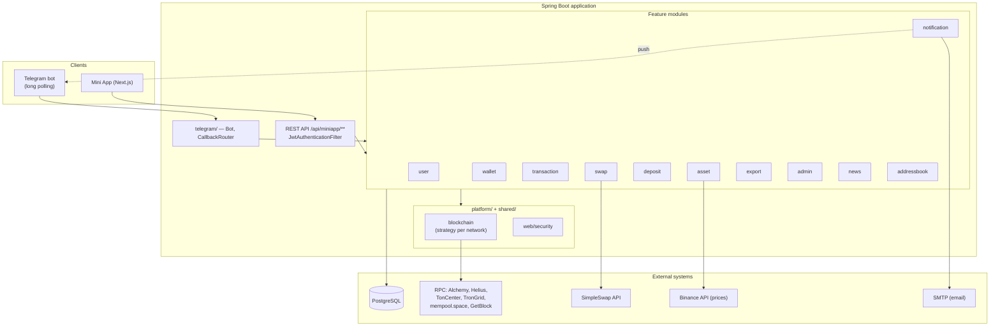
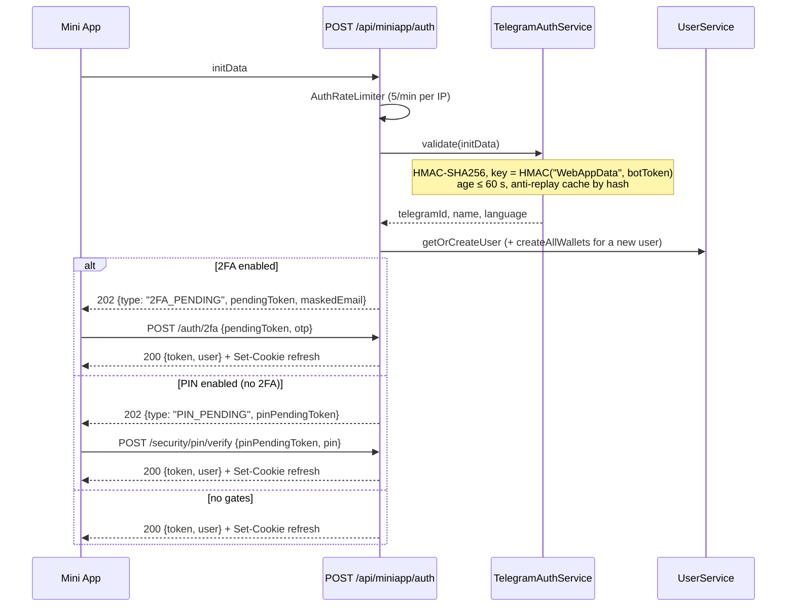
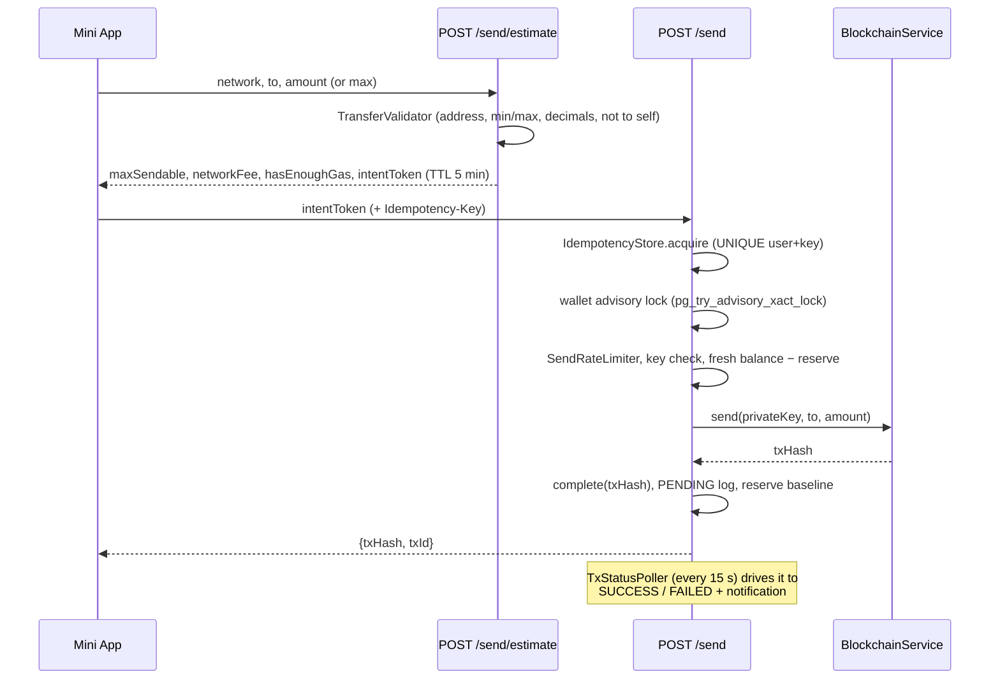
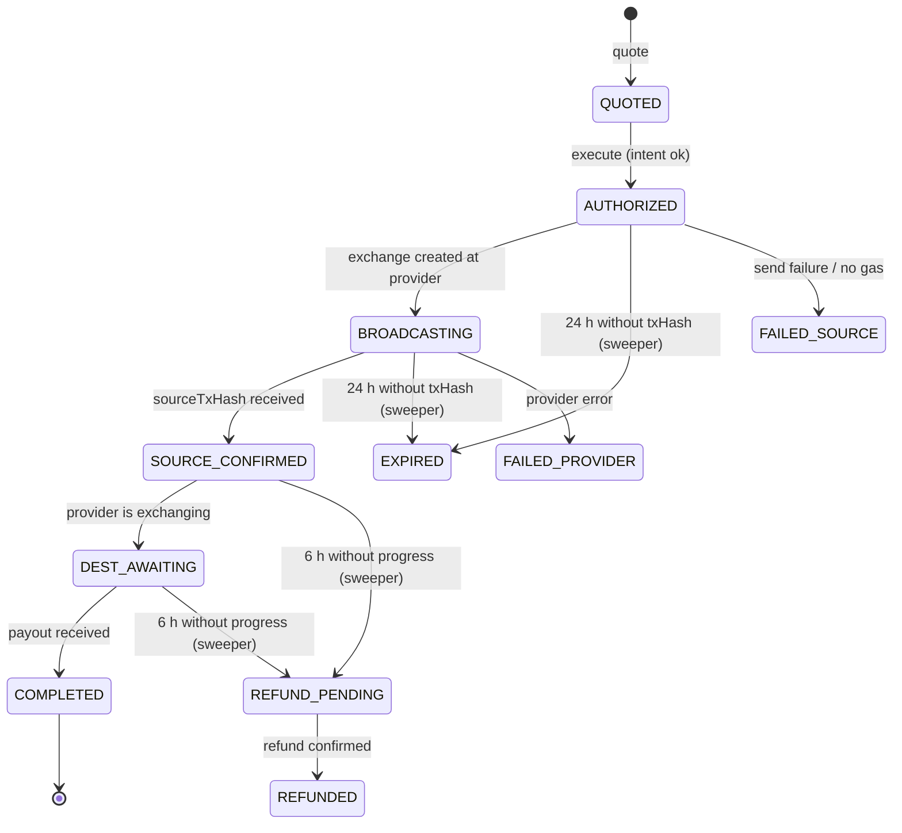
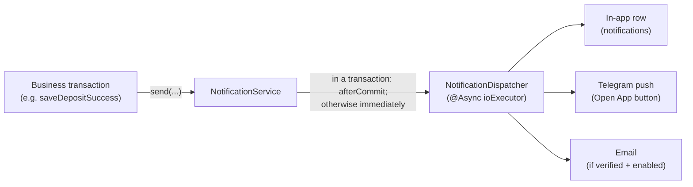

# Wallet Bot — Full Project Documentation

> A custodial multi-chain crypto wallet delivered as a Telegram Mini App.
> Backend: Java 21 + Spring Boot 4 · Frontend: Next.js (Telegram Mini App) · Database: PostgreSQL.

This document describes **what the project is, how it is built and how every key flow works** — from key generation
to sending funds, swaps and notification delivery. All class names, endpoints, numbers and limits are taken from the
actual code (package `com.example.walletbot`).

---

## Table of Contents

1. [About the project](#1-about-the-project)
2. [Tech stack](#2-tech-stack)
3. [High-level architecture](#3-high-level-architecture)
4. [Module map](#4-module-map)
5. [Supported networks and assets](#5-supported-networks-and-assets)
6. [Blockchain layer](#6-blockchain-layer)
7. [Wallet generation](#7-wallet-generation)
8. [Authentication and sessions](#8-authentication-and-sessions)
9. [PIN, 2FA and OTP](#9-pin-2fa-and-otp)
10. [Sending funds](#10-sending-funds)
11. [Swaps (cross-chain exchange)](#11-swaps-cross-chain-exchange)
12. [Receiving deposits](#12-receiving-deposits)
13. [Notifications](#13-notifications)
14. [Balances, prices and portfolio](#14-balances-prices-and-portfolio)
15. [Private key export](#15-private-key-export)
16. [Security summary](#16-security-summary)
17. [Database and migrations](#17-database-and-migrations)
18. [Background jobs](#18-background-jobs)
19. [Telegram bot](#19-telegram-bot)
20. [Admin panel](#20-admin-panel)
21. [Observability](#21-observability)
22. [Configuration (env variables)](#22-configuration-env-variables)
23. [Frontend (Mini App)](#23-frontend-mini-app)
24. [Internationalization (i18n)](#24-internationalization-i18n)
25. [Build, tests, local run](#25-build-tests-local-run)

---

## 1. About the project

**Wallet Bot** is a crypto wallet that lives inside Telegram. A user opens the bot, taps a button and lands in the
Mini App (a web application inside Telegram), where wallets in six blockchain networks are already created for them.
No sign-up, email or KYC is required: the user's identity is their Telegram account (the project is positioned as
privacy-first).

The wallet is **custodial**: private keys are generated on the server and stored encrypted in the database. In return
the user gets convenience — an instant start, access recovery through Telegram and no seed phrases (keys can still be
exported if desired — see [section 15](#15-private-key-export)).

**What the product does:**

- **Portfolio** — balances across 14 networks/tokens with prices, 24h change and charts.
- **Receive** — deposit addresses, QR codes, sharing an address into Telegram chats; incoming transactions are detected
  automatically (webhooks + scanners).
- **Send** — transfers of native coins and stablecoins with fee estimation, replay protection and a result
  notification.
- **Swaps** — exchange between assets on different networks through the SimpleSwap aggregator (1% partner fee).
- **Security** — 6-digit PIN, email 2FA, key export with one-time sessions.
- **Other** — address book, crypto news (RSS), notifications (in-app + bot push + email), multiple languages (EN/RU),
  choice of fiat currency and theme.
- **Admin panel** — statistics, user management (block/freeze), mass broadcasts.

This repository contains the backend and the Telegram bot. The Mini App frontend (Next.js) is a separate repository
and is not included here.

---

## 2. Tech stack

| Area               | Technology                                                       | Version                  | Purpose                                                       |
|--------------------|------------------------------------------------------------------|--------------------------|---------------------------------------------------------------|
| Language / runtime | Java                                                             | 21                       | —                                                             |
| Framework          | Spring Boot (WebMVC, Data JPA, Security, Cache, Actuator, Mail)  | 4.0.2                    | REST API, DI, security                                        |
| Database           | PostgreSQL + Liquibase                                           | —                        | Storage; schema only via migrations (`ddl-auto: validate`)    |
| EVM (ETH/BNB)      | web3j                                                            | core 5.0.2, crypto 5.0.0 | Keys, signing, JSON-RPC                                       |
| Bitcoin            | bitcoinj                                                         | 0.16.2                   | ECDSA keys, P2WPKH, UTXO transaction building                 |
| Solana             | solanaj (com.mmorrell)                                           | 1.28.0                   | ed25519 keys, transactions, SPL                               |
| TON                | ton4j (io.github.neodix42)                                       | 0.9.5                    | Mnemonic, WalletV4R2, Cell/BOC                                |
| Cryptography       | BouncyCastle                                                     | 1.78                     | secp256k1 for TRON and more                                   |
| Telegram           | telegrambots (client + long-polling starter)                     | 9.4.0                    | Bot and push messages                                         |
| JWT                | JJWT                                                             | 0.12.6                   | All token types                                               |
| Rate limiting      | Bucket4j + Caffeine                                              | 8.10.1                   | All rate limiters                                             |
| Cache              | Caffeine                                                         | —                        | Balances, users, charts, replay protection                    |
| Resilience         | Resilience4j                                                     | 2.2.0                    | **Only in the `swap/` module** (circuit breaker per provider) |
| HTTP client        | Apache HttpClient 5 (shared `RestTemplate` pool)                 | —                        | All RPC/price REST calls; web3j uses its own OkHttp           |
| Mapping            | MapStruct                                                        | 1.6.3                    | DTO ↔ entity                                                  |
| QR codes           | ZXing                                                            | 3.5.3                    | Receive addresses                                             |
| RSS                | ROME                                                             | 2.1.0                    | Crypto news                                                   |
| Architecture tests | ArchUnit                                                         | 1.3.0                    | `ModuleBoundaryTest` — module boundaries                      |
| Frontend           | Next.js (separate repository)                                    | —                        | Telegram Mini App                                             |

---

## 3. High-level architecture

The codebase is organized **package-per-feature**: every functional module is a bounded context with its own layers.
Two "horizontal" packages — `shared/` (the core: constants, exceptions, utilities) and `platform/` (technical
infrastructure: blockchain, web-layer security, encryption) — serve all modules.



### Layers inside a feature module

Each module is split internally into layers (not every module needs all four):

| Layer             | Contents                                                                   | Rule                                                              |
|-------------------|----------------------------------------------------------------------------|-------------------------------------------------------------------|
| `api/`            | `@RestController` under `/api/miniapp/**`, HTTP DTOs (`api/dto/`), REST mappers | No business logic: parse input, one service call, map the response |
| `application/`    | `@Service` with business logic, MapStruct mappers, rate limiters           | Flow orchestration                                                |
| `domain/`         | JPA entities, repositories, enums, service DTOs, domain validators         | Does not depend on `api/`                                         |
| `infrastructure/` | `@Configuration`, schedulers, caches/stores, `ApplicationRunner`           | Technical adapters                                                |

### Boundary rules (enforced by the ArchUnit test `ModuleBoundaryTest`)

- `shared/` depends on nothing else.
- `platform/blockchain` depends only on `shared/` and `platform/`.
- **No module depends on `telegram/`** (the bot is a driving adapter; the only link in the reverse direction is the
  port `notification/domain/PushNotificationSender`, implemented by `telegram/service/BotNotificationSender`).
- `application/` and `domain/` do not depend on any `api/`.
- Services throw domain exceptions from `shared/exception/` (or their own, like `swap/domain/exception/`); **only**
  `platform/web/advice/GlobalExceptionHandler` turns them into HTTP responses.

Violating any rule fails the build.

### Request flow

```
Telegram API ──► Bot.consume()
                   └─► CallbackRouter ─► handlers ─► feature services

Mini App ──► POST /api/miniapp/auth (initData → JWT + refresh cookie)
         ──► Bearer JWT ─► JwtAuthenticationFilter ─► controllers ─► services
```

---

## 4. Module map

### `shared/` — the core (available to everyone)

| Package      | Key classes                                                                                                                                                                                                                    | Role                                 |
|--------------|--------------------------------------------------------------------------------------------------------------------------------------------------------------------------------------------------------------------------------|--------------------------------------|
| `constant/`  | `BlockchainNetwork`, `Asset`, `SupportedCurrency`, `SupportedLanguage`, `TokenInfo`, `UserRole`, `UserStatus`, `NotificationType`, `UiTheme`, `UiEmoji`                                                                        | All domain enums                     |
| `exception/` | `BadRequestException`, `NotFoundException`, `RateLimitException`, `InsufficientFundsException`, `BlockchainRpcException`, `InvalidOtpException`, `TwoFaRequiredException`, `AccountBlockedException`, `AccountFrozenException` | Domain exceptions                    |
| `security/`  | `JwtService`, `HashingService`, `IntentTokenCodec`, `PendingTokenStore`                                                                                                                                                        | Tokens, hashing, one-time JTIs       |
| `ratelimit/` | `KeyedBucketLimiter`, `WalletActionLimiter`                                                                                                                                                                                    | Rate limiter base classes            |
| `util/`      | `AddressNormalizer`, `AmountFormatter`, `BlockchainExplorerUtil`, `EmailMasker`, `HexUtils`, `QrCodeService`                                                                                                                   | Utilities                            |
| `event/`     | `WalletCreatedEvent`, `WalletDepositEvent`                                                                                                                                                                                     | Spring events                        |
| `config/`    | `AsyncConfig` (thread pools), `CacheConfig` (Caffeine caches)                                                                                                                                                                  | Shared configuration                 |

### `platform/` — technical infrastructure

| Package           | Key classes                                                                                                                                                                                      | Role                                                    |
|-------------------|--------------------------------------------------------------------------------------------------------------------------------------------------------------------------------------------------|---------------------------------------------------------|
| `blockchain/`     | `BlockchainService`, `BlockchainServiceFactory`, `chain/*`, `token/*`, `client/*`, `cache/*`, `ratelimit/*`                                                                                      | The whole blockchain layer ([section 6](#6-blockchain-layer)) |
| `persistence/`    | `EncryptionConverter`, `EncryptionConfig`, `WalletLockService`                                                                                                                                   | Field encryption, wallet advisory locks                 |
| `web/security/`   | `SecurityConfig`, `JwtAuthenticationFilter`, `TelegramAuthService`, `CurrentUser`/`CurrentUserResolver`, `AuthRateLimiter`, `OtpRateLimiter`, `OtpVerifyRateLimiter`, `AdminMutationRateLimiter` | HTTP security                                           |
| `web/advice/`     | `GlobalExceptionHandler`, `ErrorResponse`, `RequestLocaleResolver`                                                                                                                               | Unified error handling                                  |
| `web/validation/` | `NetworkParser`, `@NetworkName`, `RawAddressPattern`                                                                                                                                             | Input validation                                        |
| `monitoring/`     | `MonitoringService`                                                                                                                                                                              | Micrometer counters                                     |
| `logging/`        | `MaskingPatternLayout`, `SecretMasker`                                                                                                                                                           | Secret masking in logs                                  |
| `config/`         | `HttpClientConfig`                                                                                                                                                                               | Shared Apache HttpClient 5 pool                         |

### Feature modules

| Module          | Purpose                                                  | Key classes                                                                                                                                                                                                |
|-----------------|----------------------------------------------------------|------------------------------------------------------------------------------------------------------------------------------------------------------------------------------------------------------------|
| `user/`         | Authorization, PIN, 2FA, OTP, refresh tokens, settings   | `UserService`, `SecurityService`, `TwoFaService`, `OtpService`, `PinLockoutService`, `RefreshTokenService`, `UserCacheService`, `UserStatusGuard`                                                          |
| `wallet/`       | Wallet creation, addresses, QR, address validation       | `WalletService`, `WalletNetworkBalanceService`, `AddressPolicyService`, `QrShareService`                                                                                                                   |
| `transaction/`  | Sending, fees, idempotency, history, statuses            | `SendTransactionService`, `SendIntentService`, `TransferValidator`, `TransactionLogService`, `HistoryService`, `TxStatusService`, `IdempotencyStore`, `TxStatusPoller`, `OutgoingReservationService`       |
| `deposit/`      | Incoming deposit detection (webhooks + scanners)         | `DepositScanService`, `BtcDepositScanner`, `TronDepositScanner`, `TonDepositScanner`, `AlchemyWebhookService`, `HeliusWebhookService`, `TonApiWebhookService`, `WalletScanScheduler`, address registrars   |
| `asset/`        | Portfolio, prices, charts, balance SSE events            | `AssetService`, `PriceService`, `ChartService`, `UserEventStream`, `DepositBalanceInvalidationListener`                                                                                                    |
| `swap/`         | Cross-chain exchanges (the most complex module)          | `SwapQuoteService`, `SwapExecutionService`, `SwapStatusService`, `SwapIntentService`, `SwapRouter`, `SimpleSwapProvider`, `SwapStatusPoller`, `SwapExpirationSweeper`                                      |
| `export/`       | Private key export                                       | `ExportService`, `ExportRateLimiter`, `ExportIntentStore`, `ExportSessionStore`                                                                                                                            |
| `notification/` | Notification delivery (in-app, push, email), broadcasts  | `NotificationService`, `NotificationDispatcher`, `BroadcastService`, `BroadcastDispatcher`, `EmailService`, `MessageService`                                                                               |
| `addressbook/`  | Address book                                             | `AddressBookService`                                                                                                                                                                                       |
| `news/`         | Crypto news (RSS, pull)                                  | `RssFeedService`, `NewsRefreshScheduler`                                                                                                                                                                   |
| `admin/`        | Admin operations                                         | `AdminUserService`, `AdminStatsService`, `AdminBroadcastService`, `AdminTransactionService`, `AdminBootstrapRunner`                                                                                        |
| `telegram/`     | Telegram bot (driving adapter)                           | `Bot`, `CallbackRouter`, `BotUiHelper`, `BotNotificationSender`, `BotMessageTracker`, `CabinetKeyboards`                                                                                                   |

---

## 5. Supported networks and assets

All networks are described by the enum `shared/constant/BlockchainNetwork`. **There are 6 base networks** and 8 token
networks — each token network delegates work to its "parent" through `getParentNetwork()` (gas lives there too:
`getGasNetwork()`).

> Note: the TON coin is displayed under the symbol **GRAM** (2026 rebrand), but the network and all code are still
> called TON.

### Base networks

| Network                 | Symbol   | Decimals | Min. send | Explorer         | RPC provider                             |
|-------------------------|----------|----------|-----------|------------------|------------------------------------------|
| `ETH`                   | ETH      | 18       | 0.0025    | etherscan.io     | Alchemy                                  |
| `BNB` (BSC, chainId 56) | BNB      | 18       | 0.0016    | bscscan.com      | Alchemy                                  |
| `BTC`                   | BTC      | 8        | 0.00014   | blockstream.info | mempool.space (reads) + GetBlock (node)  |
| `SOL`                   | SOL      | 9        | 0.012     | solscan.io       | Helius                                   |
| `TON`                   | **GRAM** | 9        | 0.1       | tonscan.org      | TonCenter                                |
| `TRX`                   | TRX      | 6        | 4         | tronscan.org     | TronGrid                                 |

### Token networks (stablecoins)

| Network      | Parent (gas) | Decimals | Min. send | Contract / mint                              |
|--------------|--------------|----------|-----------|----------------------------------------------|
| `USDT_ERC20` | ETH          | 6        | 5         | `0xdAC17F958D2ee523a2206206994597C13D831ec7` |
| `USDC_ERC20` | ETH          | 6        | 10        | `0xA0b86991c6218b36c1d19D4a2e9Eb0cE3606eB48` |
| `USDT_BEP20` | BNB          | 18       | 1         | `0x55d398326f99059fF775485246999027B3197955` |
| `USDC_BEP20` | BNB          | 18       | 1         | `0x8AC76a51cc950d9822D68b83fE1Ad97B32Cd580d` |
| `USDT_TRC20` | TRX          | 6        | 15        | `TR7NHqjeKQxGTCi8q8ZY4pL8otSzgjLj6t`         |
| `USDT_TON`   | TON          | 6        | 0.1       | jetton master `EQCxE6mU…sDs`                 |
| `USDT_SOL`   | SOL          | 6        | 1         | mint `Es9vMFr…NYB`                           |
| `USDC_SOL`   | SOL          | 6        | 1         | mint `EPjFWdd5…Dt1v`                         |

The send maximum for all of them is 10⁹ units (BTC — 21,000,000). BNB **has no wallet of its own** — it uses the ETH
EVM key (the same address).

---

## 6. Blockchain layer

The heart of the project is `platform/blockchain`. Every network implements a common interface, and a factory picks
the right implementation by enum (the Strategy pattern).

### The `BlockchainService` interface

```java
BlockchainNetwork getNetwork();

WalletKeys generateWallet();               // record WalletKeys(address, privateKey)

String getBalance(String address);

String send(String privateKey, String to, BigDecimal amount);   // returns txHash

boolean isValidAddress(String address);

String deriveAddress(String privateKey);

// default methods:
BigDecimal estimateSendFee();              // network fee

BigDecimal estimateNativeBurn(from, to, amount);  // how much native coin a token transfer burns

BigDecimal minRetainedBalance();           // non-spendable minimum (rent etc.)

String getFeeSymbol();

boolean isSendSupported();

String sendRaw(...);

String sendWithMemo(...);    // for swaps (memo/extraId)

TxStatusResult getTxStatus(txHash, from); // PENDING / CONFIRMED / REVERTED / NOT_FOUND
```

In `@PostConstruct`, `BlockchainServiceFactory` builds an `EnumMap<BlockchainNetwork, BlockchainService>`: ETH and BNB
are two instances of a shared `EvmBlockchainService` with different `chainId`s; token networks are created as
**wrappers around the parent service** (`ErcTokenService` on top of EVM, `SolTokenService` on top of SOL, etc.).

### How each chain works

|                                        | Key generation                             | Key format in DB              | Address                                                         | Fee                                                                          | Send specifics                                                                                                                                                                         |
|----------------------------------------|--------------------------------------------|-------------------------------|-----------------------------------------------------------------|------------------------------------------------------------------------------|----------------------------------------------------------------------------------------------------------------------------------------------------------------------------------------|
| **BTC** (`BtcBlockchainService`)       | bitcoinj `new ECKey()` (secp256k1)         | hex                           | P2WPKH (bech32, SegWit)                                         | Dynamic: `halfHourFee` from mempool.space, clamped to 1–500 sat/vB, fallback 20 | Greedy selection of confirmed UTXOs (re-checked via the node's `gettxout` + `SpentUtxoCache`), change output when > 600 sat, OP_RETURN memo ≤ 80 bytes; broadcast to mempool.space with fallback to GetBlock |
| **ETH / BNB** (`EvmBlockchainService`) | web3j `Keys.createEcKeyPair()`             | hex                           | `0x…` (20 bytes)                                                | **Legacy (type-0)**: `ethGasPrice() × 1.2`; NOT EIP-1559                     | Gas limit 21000 (native) / 65000+ (token, `ethEstimateGas` +20%); nonce from `PENDING`; EIP-155 signature                                                                              |
| **SOL** (`SolBlockchainService`)       | solanaj `new Account()` (ed25519)          | Base64 (64-byte secretKey)    | base58 pubkey                                                   | 5000 lamports + priority fee (Helius `getPriorityFeeEstimate`, level High)   | ComputeBudget instruction → transfer; `confirmed` blockhash; **send-and-confirm**: up to 10 attempts × 2.5 s with re-broadcast; rent-exempt minimum protection (890,880 lamports)       |
| **TON** (`TonBlockchainService`)       | ton4j `Mnemonic.generate(24)` → WalletV4R2 | **24-word mnemonic**          | non-bounceable                                                  | Fixed estimate of 0.01 TON                                                   | seqno from `getWalletInformation` (0 + stateInit for an uninitialized wallet); `validUntil = now + 90 s`; broadcast via `sendBocReturnHash`                                            |
| **TRX** (`TrxBlockchainService`)       | 32 random bytes (SecureRandom)             | hex                           | base58check with `0x41` prefix (secp256k1 + keccak, BouncyCastle) | Estimate of 1.5 TRX (native)                                                 | `walletCreateTransaction` → sign the txID (ECDSA low-s, 65 bytes) → `walletBroadcastTransaction`                                                                                       |

### Token services (`platform/blockchain/token/`)

- **`ErcTokenService`** (ERC-20/BEP-20) — balance via `ethCall balanceOf` (`0x70a08231`), transfer via
  `transfer(address,uint256)` (`0xa9059cbb`, encoded by `EvmAbiEncoder`); before sending it checks both the token
  balance and the native gas.
- **`TrcTokenService`** (USDT TRC-20) — `triggersmartcontract` with a `fee_limit` of 20 TRX; energy is estimated via
  `triggerconstantcontract` (+10%), fallback: 130,000 (new recipient) / 65,000; missing energy/bandwidth is converted
  into burned TRX (`estimateNativeBurn`).
- **`TonTokenService`** (USDT Jetton) — the jetton wallet address is resolved via `JettonWalletResolver` (30 min
  cache); the transfer is sent **to the sender's own jetton wallet** with a `createTransferBody` payload and a 0.05 TON
  gas budget.
- **`SolTokenService`** (SPL USDT/USDC) — the ATA is derived via `findProgramAddress`; a transfer = priority fee +
  `createIdempotent` (creates the recipient's ATA if needed, rent reserve ~0.00204 SOL) + `transferChecked`.

### RPC clients and limits

| Client            | Provider                                                                                       | Limit                                              |
|-------------------|------------------------------------------------------------------------------------------------|----------------------------------------------------|
| web3j (OkHttp)    | Alchemy `eth-mainnet` / `bnb-mainnet`                                                          | —                                                  |
| `GetBlockClient`  | mempool.space (balance/UTXO/fee/broadcast) + GetBlock JSON-RPC (`gettxout`, `sendrawtransaction`) | —                                               |
| `SolRpcClient`    | Helius                                                                                         | confirm loop: 10 × 2500 ms                         |
| `TonCenterClient` | TonCenter v2 (`X-API-Key`)                                                                     | `TonCenterRateLimiter`: 5 rps (200 ms pause)       |
| `TronGridClient`  | TronGrid (`TRON-PRO-API-KEY`)                                                                  | `TronGridRateLimiter`: 1100 ms interval (~0.9 rps) |

**Resilience:** blockchain RPCs intentionally have **no** circuit breakers or retries (Resilience4j is used only in
`swap/`). The strategy is graceful degradation: a failed balance read throws `BlockchainRpcException`, and
`AssetService` serves the last known balance from `wallet_network_balances` instead of caching a zero (`0` only if
nothing has ever been stored). The exceptions are SPL and TON Jetton balances, which return `0` on failure — there a
legitimate zero (no token account / jetton wallet yet) is indistinguishable from an RPC error. A failed broadcast
throws `BlockchainRpcException` (the client gets a 502).

---

## 7. Wallet generation

Wallets are created once — on the user's first contact (the `/start` command in the bot or the first `POST /auth` from
the Mini App).

**Flow (`WalletService.createAllWallets`, `@Transactional`):**

1. Take the `BASE_NETWORKS` list = all base networks **except BNB** → `{ETH, BTC, SOL, TON, TRX}` — 5 wallets in total.
   BNB and all BEP-20 tokens use the ETH key (same secp256k1 cryptography and address format).
2. For each network: if the wallet already exists — skip it (idempotency); otherwise
   `blockchainFactory.getService(network).generateWallet()` → a `WalletEntity` (address + private key) is saved to the
   database. The private key is encrypted **transparently at the JPA level** by the `EncryptionConverter` (AES,
   see [section 16](#16-security-summary)).
3. A `WalletCreatedEvent(userId, network, address)` is published.
4. Event listeners (`AFTER_COMMIT`) register the address with the deposit providers' webhooks:
    - `AlchemyAddressRegistrationListener` — adds the EVM address to the ETH and BNB webhooks (incremental PATCH);
    - `HeliusAddressRegistrationListener` — re-syncs the **full** list of SOL addresses from the database (Helius has
      no atomic "add address");
    - `TonApiAddressRegistrationListener` — subscribes the owner's TON address.
5. A generation failure in one network does not abort the others (per-network `try/catch` with a warn log).

On application startup, `ApplicationRunner`s (`AlchemyAddressBackfillRunner`, `HeliusAddressBackfillRunner`,
`TonApiAddressBackfillRunner`) sync all addresses from the database into the webhooks — in case a registration was
missed.

> **Important — recovery model:** there is no master seed. Every wallet has its own independent key. Recovering funds
> = a database dump + `ENCRYPTION_PASSWORD`/`ENCRYPTION_SALT` (these must never change — that would require
> re-encrypting the whole database).

---

## 8. Authentication and sessions

The user's identity is Telegram. On launch the Mini App receives a signed `initData` string from Telegram and exchanges
it for a session.



### initData verification (`TelegramAuthService`)

- HMAC-SHA256: secret = `HMAC_SHA256("WebAppData", BOT_TOKEN)`; `data_check_string` — sorted `key=value` pairs joined
  with `\n`; constant-time comparison.
- Freshness: `auth_date` is no older than **60 s** (`MAX_AUTH_AGE_SECONDS`) and no more than 30 s "in the future".
  initData is a one-time login credential, not a renewal mechanism.
- Anti-replay: a Caffeine cache keyed by `hash` for 65 s — a repeated initData is rejected.

### Tokens (`JwtService`, HS256)

Two independent secrets: `JWT_SECRET` (access) and `INTENT_SECRET` (everything short-lived).

| Type            | Secret        | TTL    | Key claims                                                      | Purpose                            |
|-----------------|---------------|--------|-----------------------------------------------------------------|------------------------------------|
| `access`        | JWT_SECRET    | 15 min | `sub`, `telegramId`, `ver` (tokenVersion), `role`, `typ=access` | Main session (Bearer)              |
| `pending`       | INTENT_SECRET | 15 min | `jti`, `sub`, `pending=true`                                    | Awaiting the 2FA code at login     |
| `pinPending`    | INTENT_SECRET | 10 min | `jti`, `sub`, `pinPending=true`                                 | Awaiting PIN entry                 |
| `exportPending` | INTENT_SECRET | 5 min  | `jti`, `typ=exportPending`                                      | Export: before OTP confirmation    |
| `exportSession` | INTENT_SECRET | 2 min  | `sid`, `tv`, `typ=exportSession`                                | Export: key display window         |
| `send_intent`   | INTENT_SECRET | 5 min  | `jti`, `uid`, `wid`, `net`, `to`, `amt`, `max`                  | Locked-in send intent              |
| `swap_intent`   | INTENT_SECRET | 10 min | `jti`, `uid`, networks/amounts/provider/addresses               | Locked-in swap intent              |

One-time use of `pending` tokens is enforced by `PendingTokenStore`: the JTI is marked as used in a Caffeine cache
(20 min); a repeat → `error.pending_token_used`.

### Refresh tokens (`RefreshTokenService`)

- 32 random bytes → Base64URL; only the **SHA-256 hash** is stored in the database (`RefreshTokenEntity`), TTL
  **30 days**.
- Transport — the **HttpOnly cookie** `refresh`: path `/api/miniapp/auth`, `SameSite=Strict`, `Secure` (the
  `RefreshCookie` class is the sole owner of this transport; JS never sees the token).
- **No rotation**: `POST /auth/refresh` only issues a new access JWT. This is a deliberate decision — no rotation race
  and no "lost response" problem.
- The cookie alone **does not bypass the PIN/2FA gate**: a client renewing a live session attaches its previous access
  JWT in `Authorization` (it may be expired — `JwtService.isProofOfSession` checks only the signature and subject). A
  "cookie-only" refresh for a user with PIN/2FA lands on the 202 gate again — this closes the stolen-browser-cookie-jar
  scenario.
- Revocation: `revokeAll(userId)` + increment of `UserEntity.tokenVersion` on **every** security change (logout,
  PIN/2FA/email change, admin block). Access tokens with an old `ver` are rejected by `JwtAuthenticationFilter`.

### Filter (`JwtAuthenticationFilter`)

Applies only to `/api/miniapp/**` and `/api/admin/**`. It checks: signature/expiry/`typ=access` → the user exists →
`ver` == `tokenVersion` → status is not `BLOCKED` (otherwise 403 `ACCOUNT_BLOCKED`). It puts
`AuthenticatedUser(id, telegramId, role)` into the context; controllers receive the user via `@CurrentUser UserEntity`.

---

## 9. PIN, 2FA and OTP

### PIN

- Exactly **6 digits** (`^[0-9]{6}$`).
- Storage: `BCrypt(12)` of `pin + PIN_PEPPER` (the pepper is a separate secret from env, not stored in the database).
- Lockout (`PinLockoutService`, a separate `REQUIRES_NEW` transaction so the counter is never rolled back):
  **5 failures → 15-minute lock** (429 + `Retry-After`).
- Setting a PIN requires a linked and verified email (OTP purpose `PIN_SETUP`); reset — via OTP `PIN_RESET` (it also
  works from the pre-auth screen via `pinPendingToken`: `/security/pin/reset/request-token` + `/confirm-token`).
- Any PIN mutation → `persistSecurityChange` (bump tokenVersion + revoke all refresh tokens).

### Email and OTP

- The email is stored **encrypted** (the same `EncryptionConverter`); lookups use a separate `email_hash` column
  (HMAC-SHA256); only the mask `a****@domain` is ever exposed (`EmailMasker`).
- OTP: 6 digits from `SecureRandom`, only the HMAC-SHA256 hash is stored in the database. TTL **10 min**, at most
  **5 verification attempts**, resend cooldown **120 s**. Constant-time comparison; the failure counter lives in
  `REQUIRES_NEW` (`OtpAttemptService`).
- Every code is bound to a purpose — `EmailOtpEntity.OtpPurpose`: `LOGIN`, `EMAIL_BIND`, `EMAIL_UNLINK`, `PIN_SETUP`,
  `PIN_RESET`, `TWOFA_ENABLE`, `TWOFA_DISABLE`, `EXPORT_KEYS`. A code issued for one purpose cannot be used in another
  flow.
- The email cannot be unlinked while PIN or 2FA is enabled.

### 2FA at login

If `twoFaLoginEnabled` is set, `/auth` does not issue a session; instead it sends an OTP (purpose `LOGIN`) and returns
202 with a `pendingToken`. `POST /auth/2fa` checks that the token belongs to the user, verifies the code, burns the JTI
and issues the full session. `/auth/2fa/resend` resends the code, respecting the cooldown.

---

## 10. Sending funds

Sending is built on the **intent pattern**: the client first receives a signed "request" (an intent token) with
locked-in parameters, then presents it for execution. This rules out parameter tampering between the confirmation
screen and execution, while idempotency protects against double spending.



### Step 1 — estimate (`POST /api/miniapp/send/estimate`)

`TransferValidator` checks, in order: the network supports sending → the wallet exists → the address is valid for the
network (`AddressPolicyService`) → **it is not the user's own address** → the amount is positive, does not exceed the
network precision (decimals) and is within min/max. The response contains the fee (`NetworkFee` with a USD
equivalent), the maximum sendable amount, a sufficient-gas flag and an `intentToken` (a JWT with `jti`, walletId,
network, address, amount and the `max` flag; TTL 5 minutes).

There is also a lightweight `POST /send/fee-preview` — the fee without locking in an amount.

### Step 2 — send (`POST /api/miniapp/send`)

1. **Idempotency key**: the `Idempotency-Key` header, otherwise `jti:<intent jti>`.
2. **`IdempotencyStore`** (a `SendIdempotencyEntity` row, `UNIQUE(user_id, idem_key)`, all in `REQUIRES_NEW`):
    - `CREATED` — OK to execute;
    - `ALREADY_COMPLETED` — return the stored `txHash` without re-broadcasting;
    - `IN_PROGRESS` — 429, "try again later".
      If the broadcast throws, the row is released (`releaseIfPending`) — the key can be reused.
      Idempotency is **durable** (survives restarts and replicas), not in-memory.
3. `UserStatusGuard.requireCanTransact` (FROZEN/BLOCKED — not allowed).
4. **Wallet advisory lock** (`WalletLockService`, `pg_try_advisory_xact_lock`) — a second concurrent operation gets a
   429 instead of waiting.
5. `SendRateLimiter`: 3 sends / 5 min per user, 60 s per wallet.
6. **Key integrity check**: the address is re-derived from the private key and compared with the stored one.
7. The balance is re-read **live**, and the reserve of unfinished sends (`OutgoingReservationService` — the sum of
   PENDING SEND rows) is subtracted from it. For `max=true` the amount is recomputed right before the broadcast:
   `available − fee − minRetainedBalance` (otherwise gas drift between estimate and send would break "Max" sends).
8. Broadcast → `txHash` → log `TransactionLogEntity(type=SEND, status=PENDING)` → record a balance baseline (so a
   pending send is not subtracted from the portfolio twice).

### Step 3 — confirmation

`TxStatusPoller` (every 15 s, batch of 100) polls `getTxStatus` only for PENDING SEND rows:

- `CONFIRMED` → `SUCCESS`, the actual fee is recorded in USD, balances are invalidated, a `SEND_SUCCESS` notification
  with an explorer link is sent;
- `REVERTED` → `FAILED` + `SEND_FAILED`;
- pending longer than the network timeout → `FAILED` (timeout). Timeouts: ETH/BNB 2 h, BTC 24 h, SOL 15 min,
  TON 30 min, TRX 20 min.

### History

`HistoryService.findUnifiedHistory` merges `transaction_logs` and `swap_orders` into one feed (sorted by time, pages
of up to 20). Swaps in draft statuses (`QUOTED`, `AUTHORIZED`) and those that failed without any on-chain action are
hidden; transactions whose hashes match a swap's `sourceTxHash`/`destTxHash` are deduplicated.

---

## 11. Swaps (cross-chain exchange)

Exchanges go through the **SimpleSwap** aggregator (v3 API): the user sends asset A to the provider's payin address,
and the provider sends asset B to the user's wallet. The partner fee is **1%** (setting `SWAP_PARTNER_FEE_PERCENT`);
the user pays the source network's gas (a token swap without native gas is rejected with
`SwapInsufficientGasException`).

### Endpoints

| Endpoint                    | What it does                                                                               |
|-----------------------------|--------------------------------------------------------------------------------------------|
| `GET /swap/range?from=&to=` | Provider min/max for the pair (10 min cache) — the UI shows the minimum before amount entry |
| `POST /swap/quote`          | Quote: estimated output, slippage floor (−2%), fee, `intentToken` (TTL 10 min)             |
| `GET /swap/source-fee`      | Source network fee (+ non-spendable minimum for native coins)                              |
| `POST /swap/execute`        | Execution by intent token (+ `Idempotency-Key`)                                            |
| `GET /swap/orders/{id}`     | Order status (interactive provider polling at most once per 10 s)                          |

### Execution (`SwapExecutionService.execute`)

1. Idempotency: an existing order with the same `idemKey` is returned as is; a repeated `intentJti` → conflict.
2. Checks: the wallets match the intent, balance ≥ `amountIn` (+ fee for native coins), gas for tokens,
   `SwapRateLimiter` (5 / 5 min per user, 30 s per wallet).
3. Under the wallet advisory lock, a `SwapOrderEntity` is created in status `AUTHORIZED` (`expiresAt` = intent expiry
   + 24 h, optimistic locking via `@Version`).
4. `provider.prepare` — creates the exchange at SimpleSwap → `providerOrderId` + `depositAddress` → status
   `BROADCASTING`.
5. `provider.submit` — the on-chain send to the payin address (with a memo if the network requires one — via
   `sendWithMemo`) → `sourceTxHash` → status `SOURCE_CONFIRMED`.

### Order lifecycle



### Background tracking

- **`SwapStatusPoller`** (60 s, batch of 5, per-provider rate limit): polls the provider for active statuses and maps
  SimpleSwap responses (`confirming→SOURCE_CONFIRMED`, `exchanging/sending/verifying→DEST_AWAITING`,
  `finished→COMPLETED`, `refunded→REFUNDED`…). On a terminal status it sends a `SWAP` notification and a balance event
  (for `COMPLETED` with a dest hash — a direct credit via `WalletDepositEvent`).
- **`SwapExpirationSweeper`** (60 s): `AUTHORIZED/BROADCASTING` older than 24 h without a `sourceTxHash` → `EXPIRED`;
  `SOURCE_CONFIRMED/DEST_AWAITING` with no updates for 6 h → `REFUND_PENDING`.
- **Link to deposits**: an incoming payment whose `txHash` matches the `destTxHash` of any swap of this wallet
  (`SwapStatusService.isSwapPayout` — exact match) does not create a duplicate DEPOSIT row; while a payout is "in
  flight" (`hasPayoutAwaiting`), the deposit notification is suppressed.

### Provider resilience

The only place with Resilience4j: `SwapResilienceConfig` creates a per-provider **CircuitBreaker** (window of 20 calls,
minimum 8, 50% failure threshold, "slow call" > 6 s at a 70% rate, open for 30 s) and a Bucket4j limit of ~10 rps
(SimpleSwap's limit). `SwapRouter` + `ProviderRegistry` pick the best quote among available providers (architecturally
ready for a second provider).

A known SimpleSwap v3 quirk: the `id` field from the exchange-creation response is used as `publicId` in subsequent
status requests.

---

## 12. Receiving deposits

Deposits are detected in two ways — **push (provider webhooks)** for speed and **poll (scanners)** as a safety net.
Both paths are idempotent thanks to deduplication by `txHash` (unique index `UNIQUE(wallet_id, tx_hash)`).

| Network                     | Push                                                                  | Poll             | Webhook authentication                                       |
|-----------------------------|-----------------------------------------------------------------------|------------------|--------------------------------------------------------------|
| ETH / BNB (+ ERC-20/BEP-20) | ✅ Alchemy Address Activity → `POST /api/webhooks/alchemy/{eth\|bnb}` | ❌               | HMAC-SHA256 (`X-Alchemy-Signature`, per-network signing key) |
| SOL (+ SPL)                 | ✅ Helius enhanced tx → `POST /api/webhooks/helius`                   | ❌               | Secret in the `Authorization` header (constant-time compare) |
| TON (GRAM + USDT Jetton)    | ✅ TonAPI → `POST /api/webhooks/ton?secret=…`                         | ✅ (safety net)  | Secret in the URL (TonAPI does not sign deliveries)          |
| BTC                         | ❌                                                                    | ✅               | —                                                            |
| TRX (+ TRC-20)              | ❌                                                                    | ✅               | —                                                            |

### Push path

- **Alchemy** (`AlchemyWebhookService`): parses `event.activity[]`; the wallet is looked up by address in the ETH
  network (shared EVM address); `resolveNetwork` determines the specific network from the contract address
  (USDT_ERC20 / USDC_BEP20 / native, etc.).
- **Helius** (`HeliusWebhookService`): parses `nativeTransfers` (SOL) and `tokenTransfers` (mint → USDT_SOL/USDC_SOL);
  failed transactions are skipped.
- **TonAPI** (`TonApiWebhookService`): delivers only `account_id`/`tx_hash`, so the webhook simply **triggers
  `TonDepositScanner`** for that wallet on `ioExecutor` — parsing and dedup are reused rather than duplicated. Only the
  owner's address is subscribed: Jetton transfers still notify the owner, and the scan resolves the jetton wallet
  itself. Polling for TON stays in rotation: TonAPI sends no notification when a Jetton transfer carries
  `forward_ton_amount=0`.

### Poll path

`WalletScanScheduler`: active users (seen within ≤ 48 h) are scanned every **15 min**, inactive users with a non-empty
history — every **2 h**. `DepositScanService` debounces by `wallet.lastDepositScanAt`: BTC — 12 min, TRX/TON — 2 min.
Scanners:

- `BtcDepositScanner` — mempool.space `/address/{addr}/txs`, confirmed only, skipping the wallet's own spends
  (self/change);
- `TronDepositScanner` — TronGrid: native `TransferContract` + TRC-20 `Transfer` for the USDT contract;
- `TonDepositScanner` — TonCenter: incoming `in_msg` (minimum 0.001 TON) + Jetton internal transfer
  (op `0x178d4519`).

### What happens after detection

```
Scanner/webhook → TransactionLogService.saveDepositSuccess
   ├─ txHash already present? → exit (dedup)
   ├─ is it a swap payout? → only WalletDepositEvent (no DEPOSIT row)
   ├─ DEPOSIT/SUCCESS row (+ usdValue at the current price)
   ├─ NotificationType.DEPOSIT → NotificationService.send → (afterCommit, @Async) in-app + push + email
   └─ WalletDepositEvent → (AFTER_COMMIT) DepositBalanceInvalidationListener
        ├─ creditBalance: optimistic balance-cache credit
        └─ UserEventStream: SSE "balance" event → the Mini App reloads the portfolio
```

---

## 13. Notifications

Event notifications (deposit, send result, swap, account status change) go through `NotificationService.send`;
delivery happens in `NotificationDispatcher`.



Why it works this way:

1. **Not part of a rollback**: if `send` is called inside a transaction, delivery is registered via
   `TransactionSynchronizationManager.registerSynchronization(...).afterCommit()` — a rolled-back business operation
   leaves no notification; outside a transaction delivery happens immediately.
2. **Does not block the calling thread**: `NotificationDispatcher.deliver` is `@Async("ioExecutor")`.
3. **Channels** (`NotificationDispatcher.deliver`): in-app is always written; push — if the type is critical or
   `notifyPushEnabled` is on; email — if critical/enabled and the email is verified. Critical types (always delivered):
   `ACCOUNT_FROZEN/UNFROZEN/BLOCKED/UNBLOCKED`.

The same pattern (afterCommit + `@Async`) is used by balance SSE signals and cache invalidation (`WalletDepositEvent` is
a plain Spring event) and by mass broadcasts (`BroadcastDispatcher`).

Notification types (`NotificationType`): `SEND_SUCCESS`, `SEND_FAILED`, `DEPOSIT`, `SWAP`, `APP_UPDATE`, `NEWS`,
`ACCOUNT_FROZEN`, `ACCOUNT_UNFROZEN`, `ACCOUNT_BLOCKED`, `ACCOUNT_UNBLOCKED`.

---

## 14. Balances, prices and portfolio

### Three-tier balance cache (`AssetService.getBalance`)

| Tier | Storage                                                  | TTL  |
|------|----------------------------------------------------------|------|
| 1    | Caffeine in-memory (`balanceCache`)                      | 15 s |
| 2    | DB table `wallet_network_balances` (survives restarts)   | 60 s |
| 3    | Live RPC → the result is written to tiers 1–2            | —    |

To prevent "the deposit arrived but the cache was seeded with a stale value" races, a per-user **epoch counter** is
used: `creditBalance` (the optimistic credit on deposit) bumps the epoch, and a concurrent write of a stale value is
discarded.

### Portfolio (`buildPortfolio`)

For each of the 14 networks: `confirmed` (from the caches) minus `reserved` (the sum of PENDING sends from
`transaction_logs`) = the **spendable** balance the user sees. A baseline taken at broadcast time prevents the pending
amount from being subtracted twice. The USD valuation and `change24h` come from `PriceService`; the "portfolio PnL" is
the 24h change over current holdings (not cost basis). Wallet balances are collected in parallel on the
`balanceExecutor` pool (20 threads), and the result is cached for 25 s.

### Prices and rates (`PriceService`, `ChartService`)

| Data                   | Source                                                              | Frequency            |
|------------------------|---------------------------------------------------------------------|----------------------|
| Spot prices + 24h change | Binance `GET /api/v3/ticker/24hr` (BTC/ETH/BNB/SOL/TON/TRX to USDT) | every 2 min        |
| Sparklines (7 points)  | Binance `GET /api/v3/klines` (1d × 7)                               | every 10 min         |
| On-demand charts       | Binance klines; periods 1/7/30/365/max                              | `chart` cache 15 min |
| Fiat rates             | `@fawazahmed0/currency-api` (jsDelivr CDN, fallback pages.dev)      | hourly               |

USDT/USDC are hard-coded to 1.0. The GRAM symbol is mapped to the Binance pair `TONUSDT`. Supported fiat currencies
(`SupportedCurrency`): **USD, EUR, RUB, AMD, GBP**.

### Instant refresh

On a deposit/swap the frontend receives an SSE `balance` event (`GET /api/miniapp/events`, `UserEventStream`, emitter
timeout 15 min) and re-fetches the portfolio — the balance updates without a manual refresh.

---

## 15. Private key export

This is the only operation that shows raw keys to the user, so it carries the heaviest protection. Four steps
(`ExportController`, `/api/miniapp/security/export/*`):

```
POST /request ── requires a verified email; sends an OTP (EXPORT_KEYS);
│                issues an exportPending token (5 min) + a one-time JTI
▼
POST /confirm ── OTP check; the JTI is burned atomically (ISSUED→CONSUMED);
│                issues an exportSession token (2 min) + the wallet list
▼
POST /reveal ── checks the sid + a MATCHING tokenVersion (a password change/logout
│               kills the session instantly); returns the decrypted keys
▼
POST /close ── the session is burned (or expires on its own via TTL)
```

Guarantees:

- **Burn-after-use**: the intent JTI is one-time; the session is burned on a foreign user, a tokenVersion mismatch, an
  explicit close or by TTL.
- All responses carry `no-store`, `Referrer-Policy: no-referrer` and similar headers.
- `ExportRateLimiter` limit: **10 requests / 24 h** per user; OTP attempts are additionally limited by
  `OtpVerifyRateLimiter`.
- Full telemetry:
  `security.export.requested / confirmed / revealed{network} / failed.otp / failed.burned / failed.ratelimit / failed.token_invalid`.

Exported key formats: hex (BTC/EVM/TRX), Base64 of the 64-byte secretKey (SOL), 24-word mnemonic (TON).

---

## 16. Security summary

### Data at rest

- **Private keys and emails** are encrypted by the transparent JPA converter `EncryptionConverter` → Spring Security
  `Encryptors.text(password, salt)`: AES-256-CBC, a random IV per record, a PBKDF2-derived key. Requirements:
  `ENCRYPTION_PASSWORD` ≥ 24 characters, `ENCRYPTION_SALT` — hex ≥ 16. **These values must never change** without
  re-encrypting the whole database.
- PIN — BCrypt(12) + pepper; OTPs and refresh tokens — hashes only; the email is duplicated as an HMAC hash for
  lookups.

### HTTP perimeter (`SecurityConfig`)

- Stateless, CSRF disabled, CSP `default-src 'none'`, `X-Frame-Options: DENY`, one-year HSTS,
  `Referrer-Policy: no-referrer`.
- CORS: only origins from `CORS_ORIGINS` (validated: absolute, https except loopback, no wildcards),
  `allowCredentials=true`, headers `Authorization, Content-Type, Idempotency-Key`.
- Public endpoints (everything else under `/api/miniapp/**` requires a JWT): `POST /auth`, `/auth/refresh`,
  `/auth/2fa`, `/auth/2fa/resend`, `/security/pin/verify`, `/security/pin/reset/request-token`,
  `/security/pin/reset/confirm-token`, `GET /i18n`, `GET /actuator/health`, webhooks
  `POST /api/webhooks/{alchemy/**,helius,ton}` (authenticated by the provider's secret, not a JWT).
- `/api/admin/**` — `ADMIN` role only; `/api/internal/**` and other actuator paths — `denyAll`.

### User statuses

`ACTIVE` → everything allowed; `FROZEN` → login and viewing allowed, transactions are not
(`UserStatusGuard.requireCanTransact` → 403 `ACCOUNT_FROZEN`); `BLOCKED` → cut off already at the filter
(403 `ACCOUNT_BLOCKED`).

### Rate limiters (all Bucket4j + Caffeine unless noted)

| Limiter                                        | Key                                                      | Limit                       |
|------------------------------------------------|----------------------------------------------------------|-----------------------------|
| `AuthRateLimiter`                              | IP (honours `TRUSTED_PROXY_COUNT` for X-Forwarded-For)   | 5 / min                     |
| `OtpRateLimiter` (code issuance)               | userId                                                   | 3 / 5 min                   |
| `OtpVerifyRateLimiter` (code verification)     | userId                                                   | 10 / 5 min                  |
| `SendRateLimiter` (sliding window)             | userId + wallet                                          | 3 / 5 min; 60 s per wallet  |
| `SwapRateLimiter` (sliding window)             | userId + wallet                                          | 5 / 5 min; 30 s per wallet  |
| `ExportRateLimiter`                            | userId                                                   | 10 / 24 h                   |
| `AdminMutationRateLimiter`                     | adminId                                                  | 30 / min                    |
| `TonCenterRateLimiter` / `TronGridRateLimiter` | global per upstream                                      | 5 rps / ~0.9 rps            |
| PIN lockout (`PinLockoutService`)              | userId                                                   | 5 failures → 15 min         |

### Error handling (`GlobalExceptionHandler` — the single point)

| Exception                                            | HTTP | Code                                 |
|------------------------------------------------------|------|--------------------------------------|
| `BadRequestException`, `IllegalArgumentException`    | 400  | `BAD_REQUEST`                        |
| `TwoFaRequiredException`                             | 202  | (`TwoFaRequiredResponse` body)       |
| `NotFoundException`                                  | 404  | `NOT_FOUND`                          |
| `ObjectOptimisticLockingFailureException`            | 409  | `CONCURRENT_UPDATE`                  |
| `MaxUploadSizeExceededException`                     | 413  | `FILE_TOO_LARGE`                     |
| `MethodArgumentNotValidException`                    | 422  | `VALIDATION_ERROR` (+fieldErrors)    |
| `InsufficientFundsException`                         | 422  | `INSUFFICIENT_FUNDS`                 |
| `InvalidOtpException`                                | 422  | `INVALID_OTP`                        |
| `RateLimitException`                                 | 429  | + `Retry-After`                      |
| `AccountFrozenException` / `AccountBlockedException` | 403  | `ACCOUNT_FROZEN` / `ACCOUNT_BLOCKED` |
| `BlockchainRpcException`                             | 502  | `BLOCKCHAIN_RPC_ERROR`               |
| anything else                                        | 500  | `INTERNAL_ERROR`                     |

Raw stack traces, SQL errors and third-party RPC responses are never returned to the client.

### Logs

`MaskingPatternLayout` + `SecretMasker` (Logback) mask, in every line, the values of the query parameters
`api_key/token/secret/key/...` and keys in paths like `alchemy.com/v2/<key>` → `***`.

---

## 17. Database and migrations

The schema is managed by **Liquibase** (`db/changelog/changelog-master.xml` → `changes/*.xml`, numbered up to
`055-*`). JPA runs with `ddl-auto: validate` — any schema change requires a new migration. **Never edit an applied
changeset** (checksums break and the application will not start) — only add new ones.

### Key tables

| Table                     | Entity                       | What it stores                                                                                                                                                                                                       |
|---------------------------|------------------------------|----------------------------------------------------------------------------------------------------------------------------------------------------------------------------------------------------------------------|
| `users`                   | `UserEntity`                 | Telegram identity, settings (language/currency/theme/notifications), email (encrypted) + `email_hash`, PIN (`pin_hash`, lockout), `token_version`, `two_fa_login_enabled`, role/status (+reason), `@Version` (optimistic locking) |
| `wallets`                 | `WalletEntity`               | address, **private key (encrypted)**, network, `last_deposit_scan_at` (scan debounce)                                                                                                                               |
| `wallet_network_balances` | `WalletNetworkBalanceEntity` | DB tier of the balance cache, `UNIQUE(wallet_id, network)`                                                                                                                                                           |
| `transaction_logs`        | `TransactionLogEntity`       | SEND/SWAP/DEPOSIT: amounts, addresses, `tx_hash` (`UNIQUE(wallet_id, tx_hash)`), status PENDING/SUCCESS/FAILED, usd_value, fee_usd                                                                                  |
| `swap_orders`             | `SwapOrderEntity`            | The full swap lifecycle: pair, amounts (in/expected/min/actual), provider, payin address, both tx hashes, status, `idem_key`, `intent_jti`, `@Version`                                                              |
| `refresh_tokens`          | `RefreshTokenEntity`         | SHA-256 hash of the token, expiry, revocation mark                                                                                                                                                                   |
| `email_otp`               | `EmailOtpEntity`             | Code hash, purpose, attempts, expiry, context                                                                                                                                                                        |
| `send_idempotency`        | `SendIdempotencyEntity`      | `UNIQUE(user_id, idem_key)` + txHash — durable send idempotency                                                                                                                                                      |
| `notifications`           | `NotificationEntity`         | In-app notifications (+ link to a broadcast)                                                                                                                                                                         |
| `address_book`            | `AddressBookEntity`          | Saved recipient addresses                                                                                                                                                                                            |
| `broadcasts`              | `BroadcastEntity`            | Admin broadcasts (channels, audience, image, status, counter)                                                                                                                                                        |

Tests run on in-memory H2; `WalletBotApplicationTests.contextLoads` is the only one that needs a real PostgreSQL
(tagged `@Tag("integration")`, excluded by default).

---

## 18. Background jobs

All `@Scheduled` jobs in the project (fixedDelay unless stated otherwise):

| Job                                     | Interval   | What it does                                         |
|-----------------------------------------|------------|------------------------------------------------------|
| `TxStatusPoller`                        | 15 s       | Confirms PENDING sends (batch of 100)                |
| `SwapStatusPoller`                      | 60 s       | Polls swap statuses from the provider (batch of 5)   |
| `SwapExpirationSweeper`                 | 60 s       | EXPIRED (24 h) and REFUND_PENDING (6 h)              |
| `WalletScanScheduler.scanActiveUsers`   | 15 min     | Deposit scan for active (≤ 48 h) users               |
| `WalletScanScheduler.scanInactiveUsers` | 2 h        | Scan for inactive users who have had deposits        |
| `PriceService.updatePrices`             | 2 min      | Binance spot prices                                  |
| `PriceService.updateMarketData`         | 10 min     | Sparklines                                           |
| `PriceService.updateFiatRates`          | 1 h        | Fiat rates                                           |
| `NewsRefreshScheduler`                  | 8 min      | Refreshes the RSS cache (EN+RU)                      |
| `OtpCleanupScheduler`                   | 1 h        | Cleans up expired/used OTPs                          |
| `BroadcastImageCleanupScheduler`        | cron 04:00 | Deletes orphaned broadcast images                    |

Pools (`AsyncConfig`): **`ioExecutor`** (core 4 / max 16 / queue 200, `CallerRunsPolicy`) — deposit scans, webhook
triggers, broadcasts, RSS; **`balanceExecutor`** (fixed 20) — parallel balance reads.

---

## 19. Telegram bot

The bot is a **thin adapter**: the whole wallet UI lives in the Mini App, and the bot handles entry and push
notifications.

- `Bot` (`SpringLongPollingBot`, long polling): `/start` → delete the user's message → create wallets if there are none
  → show the welcome screen with an inline Mini App button (`CabinetKeyboards.welcomeMenu`). Any other text is simply
  deleted.
- **Single-screen UX**: `BotMessageTracker` (Caffeine, 7 days) remembers the bot's last message in the chat — new
  screens replace old ones, so the chat stays clean.
- Callback buttons are routed by `CallbackRouter` across a list of `CallbackHandler`s (the first `canHandle` wins).
- `BotNotificationSender` implements the `PushNotificationSender` port from `notification/`: HTML messages (4096
  limit) or photos (caption 1024), an optional explorer link; **every push carries an "Open App" button**
  (`WebAppInfo` → `MINI_APP_URL`). An uploaded broadcast photo is reused via its Telegram `file_id`.

---

## 20. Admin panel

Endpoints under `/api/admin/**` (role `ADMIN`; the first admins are assigned on startup by `AdminBootstrapRunner` from
`ADMIN_TELEGRAM_IDS`). All mutations go through `AdminMutationRateLimiter` (30/min); actions on oneself are forbidden.

| Area                                                     | Capabilities                                                                                                                                                                                         |
|----------------------------------------------------------|------------------------------------------------------------------------------------------------------------------------------------------------------------------------------------------------------|
| Users (`AdminUserService`)                               | Search/list (pages ≤ 100), **block / freeze / unblock / force-logout**. Block and force-logout kill sessions instantly (bump tokenVersion + revokeAll); the user receives a critical notification |
| Statistics (`AdminStatsService`)                         | Volume = send + swap in USD (deposits are not counted), revenue = 1% of swaps, deposits, user counts by status; periods day/week/month/all                                                          |
| Transactions (`AdminTransactionService`)                 | Browse transaction logs (all / per user)                                                                                                                                                             |
| Broadcasts (`AdminBroadcastService` → `BroadcastService`) | Creation, image (multipart ≤ 5 MB), audience ALL / WITH_EMAIL, channels IN_APP/BOT/EMAIL, asynchronous fan-out (`BroadcastDispatcher`, 200 users/page, 40 ms push throttling)                       |

---

## 21. Observability

- Actuator: only `health`, `metrics` and `prometheus` are exposed (everything else is `denyAll`).
- Micrometer counters (`MonitoringService`):
    - `security.auth.failed`, `security.pin.failed`, `security.otp.failed`
    - `transaction.sent`, `notification.sent`
    - the export family: `security.export.requested`, `.confirmed`, `.revealed{network}`, `.failed.otp`,
      `.failed.burned`, `.failed.ratelimit`, `.failed.token_invalid`
- Logs: INFO level, secret masking (see section 16).

---

## 22. Configuration (env variables)

### Required secrets

| Variable                                  | Purpose                                                                     |
|-------------------------------------------|-----------------------------------------------------------------------------|
| `BOT_TOKEN`                               | Telegram bot token (also the initData verification key)                     |
| `DB_URL`, `DB_USERNAME`, `DB_PASSWORD`    | PostgreSQL (`DB_PASSWORD` = `POSTGRES_PASSWORD` from docker-compose)        |
| `JWT_SECRET`                              | Access token signing (≥ 32 characters)                                      |
| `INTENT_SECRET`                           | Separate secret for intent/pending tokens (≥ 32 characters)                 |
| `ENCRYPTION_PASSWORD` / `ENCRYPTION_SALT` | AES encryption of keys and emails (≥ 24 chars / hex ≥ 16). **Never change!** |
| `PIN_PEPPER`                              | Pepper for the PIN and the OTP/email HMAC hashes                            |

### RPC and webhooks

| Variable                                                                                                  | Purpose                                                    |
|-----------------------------------------------------------------------------------------------------------|------------------------------------------------------------|
| `ALCHEMY_KEY`                                                                                             | ETH + BNB RPC                                              |
| `ALCHEMY_NOTIFY_AUTH_TOKEN`, `ALCHEMY_WEBHOOK_ETH_ID/_SIGNING_KEY`, `ALCHEMY_WEBHOOK_BNB_ID/_SIGNING_KEY` | EVM deposit webhooks (empty = disabled)                    |
| `HELIUS_KEY`                                                                                              | Solana RPC + webhook management API                        |
| `HELIUS_WEBHOOK_ID`, `HELIUS_WEBHOOK_AUTH_HEADER`                                                         | SOL deposit webhook                                        |
| `TON_KEY`                                                                                                 | TonCenter RPC                                              |
| `TONAPI_WEBHOOK_ID`, `TONAPI_WEBHOOK_SECRET`, `TONAPI_WEBHOOK_TOKEN`                                      | TON deposit webhook (TonAPI/TON Console)                   |
| `TRON_KEY`                                                                                                | TronGrid RPC                                               |
| `GETBLOCK_BTC_URL`                                                                                        | BTC node for broadcasting (reads use mempool.space, no key) |
| `SIMPLESWAP_KEY`                                                                                          | Swap API                                                   |

### Behaviour and defaults

| Variable                                                          | Default               | Purpose                                                                              |
|-------------------------------------------------------------------|-----------------------|--------------------------------------------------------------------------------------|
| `JWT_EXPIRATION_MINUTES`                                          | 15                    | Access token TTL                                                                     |
| `JWT_REFRESH_TTL_DAYS`                                            | 30                    | Refresh token TTL                                                                    |
| `COOKIE_SECURE`                                                   | true                  | `Secure` flag on the refresh cookie (false for http dev)                             |
| `CORS_ORIGINS`                                                    | http://localhost:3000 | Allowed origins                                                                      |
| `MINI_APP_URL`                                                    | http://localhost:3000 | Mini App URL (bot buttons)                                                           |
| `APP_PUBLIC_URL`                                                  | http://localhost:8080 | Public URL (QR images must be reachable by Telegram's servers)                       |
| `MAIL_USERNAME/PASSWORD`, `MAIL_SMTP_HOST/PORT`                   | gmail:587             | SMTP for OTPs                                                                        |
| `MAIL_OTP_TTL` / `MAIL_OTP_MAX_ATTEMPTS` / `MAIL_RESEND_COOLDOWN` | 10 / 5 / 120          | OTP parameters                                                                       |
| `ADMIN_TELEGRAM_IDS`                                              | —                     | Admin bootstrap                                                                      |
| `TRUSTED_PROXY_COUNT`                                             | 0                     | How many proxies to trust when parsing X-Forwarded-For (must be 1 behind a reverse proxy!) |
| `SWAP_PARTNER_FEE_PERCENT` / `SWAP_SLIPPAGE_PERCENT`              | 0.01 / 0.02           | Swap economics                                                                       |
| `SWAP_INTENT_TTL_SECONDS`                                         | 600                   | Swap intent execution window                                                         |

---

## 23. Frontend (Mini App)

The frontend is a separate repository (Next.js) and is not part of this repository.

Key integration points with the backend:

- API base — `NEXT_PUBLIC_API_URL` (default `/api/miniapp`).
- The frontend receives UI strings from the backend (`GET /i18n?lang=`) — the backend is the single source of
  translations, including pre-auth screens (PIN/2FA/blocked).
- The access token lives **only in memory**; the frontend proactively renews it about 60 s before expiry via
  `/auth/refresh`; if a refresh genuinely fails, a `SessionExpiredScreen` is shown (the Mini App must be reopened to
  get a fresh initData).
- Live balance updates — via SSE `GET /api/miniapp/events`.
- The UI theme is stored in the user's database record (the `theme` field) and hydrated on startup — it survives
  localStorage resets on Telegram Desktop.

---

## 24. Internationalization (i18n)

- All strings live in `src/main/resources/i18n/messages_en.properties` and `messages_ru.properties`. **A new key is
  always added to both files.**
- `MessageService` loads the bundles on startup, resolves by the user's language (`SupportedLanguage`, falling back to
  the default), and supports `{n}` substitutions and `{e:EMOJI}` emoji placeholders.
- The bot has key variants with a `.bot` suffix (pushes prefer them).
- The public `GET /api/miniapp/i18n?lang=` returns the UI dictionary without authorization — so that the
  PIN/2FA/blocked/session-expired screens render before login.

---

## 25. Build, tests, local run

```bash
# Build
./mvnw clean package              # with tests
./mvnw clean package -DskipTests

# Tests
./mvnw test
./mvnw test -Dtest=ModuleBoundaryTest   # architecture tests only
./mvnw test -Pintegration-tests        # + contextLoads (requires PostgreSQL)

# Local run — PostgreSQL + backend in Docker
docker compose up -d

# Or only PostgreSQL in Docker, the backend as a plain process
docker compose up -d db
./mvnw spring-boot:run
```

- `.env` (in the repository root) — `POSTGRES_PASSWORD`/`DB_PASSWORD` (the same value) and the variables from
  [section 22](#22-configuration-env-variables); `BOT_TOKEN` and `GETBLOCK_BTC_URL` are required — the application
  will not start without them.
- Test profile (`src/test/resources/application.properties`): in-memory H2, mock secrets, Telegram bot
  auto-configuration excluded. The whole suite is unit tests + ArchUnit; only `contextLoads` needs a real PostgreSQL
  and is excluded by default (tag `integration`, run with `-Pintegration-tests`).
