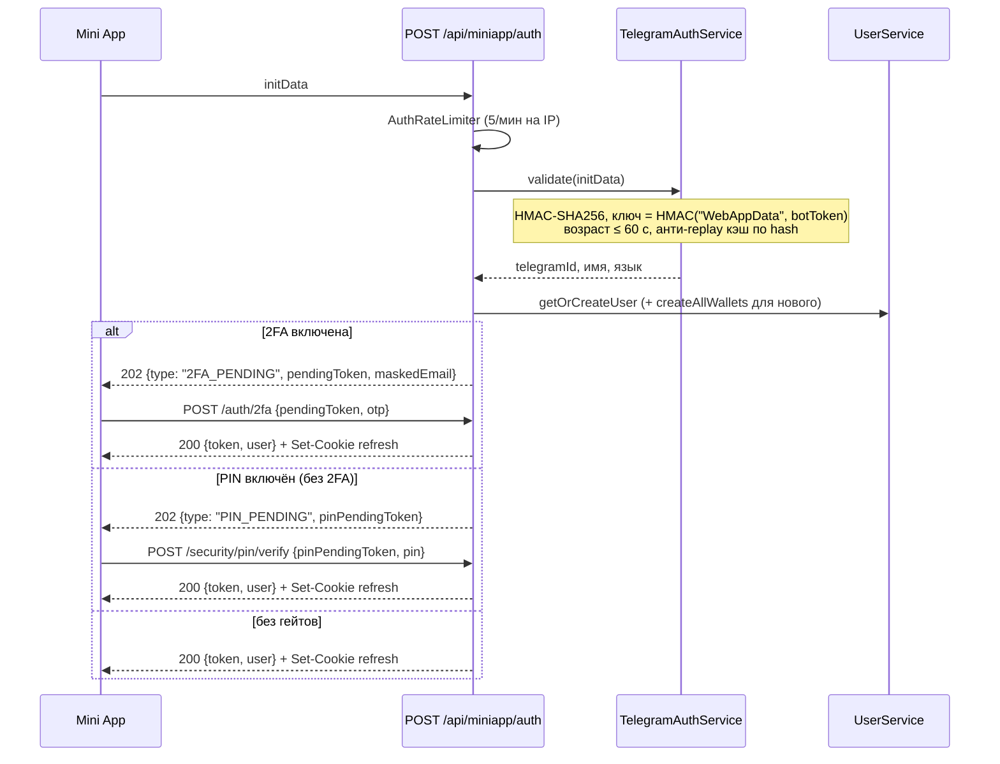
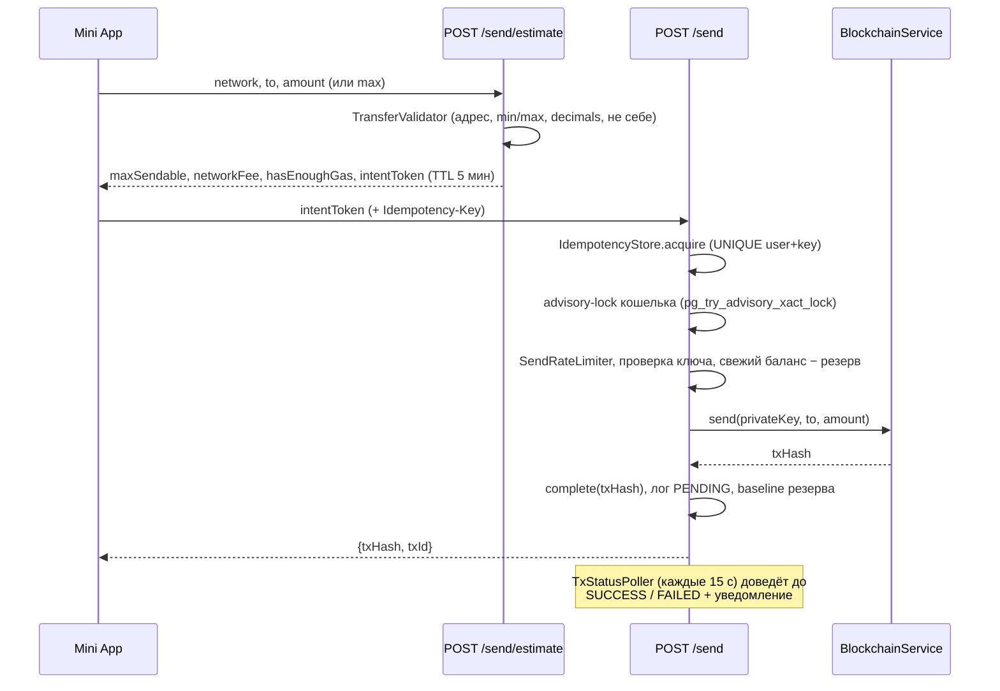
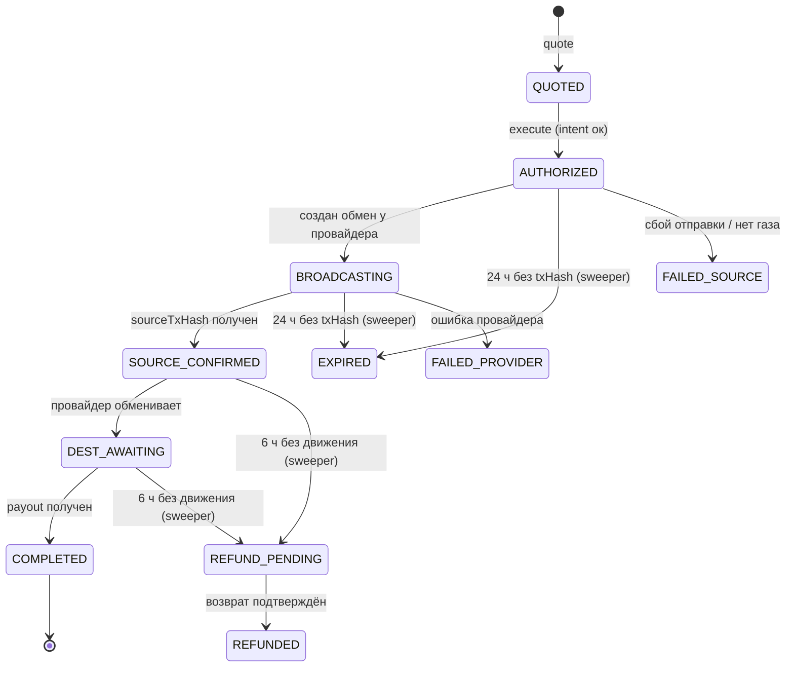
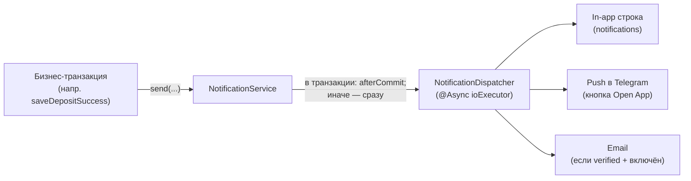

# Wallet Bot — полная документация проекта

> Кастодиальный мультичейн-криптокошелёк в виде Telegram Mini App.
> Backend: Java 21 + Spring Boot 4 · Frontend: Next.js (Telegram Mini App) · БД: PostgreSQL.

Документ описывает **что это за проект, как он устроен и как работает каждый ключевой поток** — от генерации кошельков
до отправки средств, свапов и доставки уведомлений. Все имена классов, эндпоинтов, чисел и лимитов взяты из реального
кода (пакет `com.example.walletbot`).

---

## Оглавление

1. [О проекте](#1-о-проекте)
2. [Технологический стек](#2-технологический-стек)
3. [Архитектура верхнего уровня](#3-архитектура-верхнего-уровня)
4. [Карта модулей](#4-карта-модулей)
5. [Поддерживаемые сети и активы](#5-поддерживаемые-сети-и-активы)
6. [Блокчейн-слой](#6-блокчейн-слой)
7. [Генерация кошельков](#7-генерация-кошельков)
8. [Аутентификация и сессии](#8-аутентификация-и-сессии)
9. [PIN, 2FA и OTP](#9-pin-2fa-и-otp)
10. [Отправка средств](#10-отправка-средств)
11. [Свапы (обмен между сетями)](#11-свапы-обмен-между-сетями)
12. [Приём депозитов](#12-приём-депозитов)
13. [Уведомления](#13-уведомления)
14. [Балансы, цены и портфель](#14-балансы-цены-и-портфель)
15. [Экспорт приватных ключей](#15-экспорт-приватных-ключей)
16. [Безопасность — сводка](#16-безопасность--сводка)
17. [База данных и миграции](#17-база-данных-и-миграции)
18. [Фоновые задачи](#18-фоновые-задачи)
19. [Telegram-бот](#19-telegram-бот)
20. [Админ-панель](#20-админ-панель)
21. [Наблюдаемость](#21-наблюдаемость)
22. [Конфигурация (env-переменные)](#22-конфигурация-env-переменные)
23. [Фронтенд (Mini App)](#23-фронтенд-mini-app)
24. [Интернационализация (i18n)](#24-интернационализация-i18n)
25. [Сборка, тесты, локальный запуск](#25-сборка-тесты-локальный-запуск)

---

## 1. О проекте

**Wallet Bot** — это криптокошелёк, живущий внутри Telegram. Пользователь открывает бота, нажимает кнопку — и попадает в
Mini App (веб-приложение внутри Telegram), где у него уже созданы кошельки в шести блокчейн-сетях. Никакой регистрации,
email и KYC не требуется: личность пользователя — это его Telegram-аккаунт (проект позиционируется как privacy-first).

Кошелёк **кастодиальный**: приватные ключи генерируются на сервере и хранятся в базе данных в зашифрованном виде. Взамен
пользователь получает удобство — мгновенный старт, восстановление доступа через Telegram, отсутствие seed-фраз (но при
желании ключи можно экспортировать — см. [раздел 15](#15-экспорт-приватных-ключей)).

**Что умеет продукт:**

- **Портфель** — балансы по 14 сетям/токенам с ценами, изменением за 24 ч и графиками.
- **Приём** — адреса для депозитов, QR-коды, шаринг адреса в чаты Telegram; входящие транзакции обнаруживаются
  автоматически (вебхуки + сканеры).
- **Отправка** — перевод нативных монет и стейблкоинов с расчётом комиссии, защитой от повторов и уведомлением о
  результате.
- **Свапы** — обмен между активами разных сетей через агрегатор SimpleSwap (партнёрская комиссия 1%).
- **Безопасность** — PIN-код (6 цифр), 2FA по email, экспорт ключей с одноразовыми сессиями.
- **Прочее** — адресная книга, крипто-новости (RSS), уведомления (in-app + push в бота + email), мультиязычность (
  EN/RU), выбор фиатной валюты и темы.
- **Админка** — статистика, управление пользователями (блокировка/заморозка), массовые рассылки.

В этом репозитории — backend и Telegram-бот. Фронтенд Mini App (Next.js) — отдельный приватный репозиторий и сюда не
входит.

---

## 2. Технологический стек

| Область             | Технология                                                             | Версия                   | Зачем                                                        |
|---------------------|------------------------------------------------------------------------|--------------------------|--------------------------------------------------------------|
| Язык / платформа    | Java                                                                   | 21                       | —                                                            |
| Фреймворк           | Spring Boot (WebMVC, Data JPA, Security, Cache, Actuator, Mail)        | 4.0.2                    | REST API, DI, безопасность                                   |
| БД                  | PostgreSQL + Liquibase                                                 | —                        | Хранение; схема только через миграции (`ddl-auto: validate`) |
| EVM (ETH/BNB)       | web3j                                                                  | core 5.0.2, crypto 5.0.0 | Ключи, подпись, JSON-RPC                                     |
| Bitcoin             | bitcoinj                                                               | 0.16.2                   | Ключи ECDSA, P2WPKH, сборка UTXO-транзакций                  |
| Solana              | solanaj (com.mmorrell)                                                 | 1.28.0                   | Ключи ed25519, транзакции, SPL                               |
| TON                 | ton4j (io.github.neodix42)                                             | 0.9.5                    | Мнемоника, WalletV4R2, Cell/BOC                              |
| Криптография        | BouncyCastle                                                           | 1.78                     | secp256k1 для TRON и др.                                     |
| Telegram            | telegrambots (client + long-polling starter)                           | 9.4.0                    | Бот и push-сообщения                                         |
| JWT                 | JJWT                                                                   | 0.12.6                   | Все виды токенов                                             |
| Rate limiting       | Bucket4j + Caffeine                                                    | 8.10.1                   | Все рейт-лимитеры                                            |
| Кэш                 | Caffeine                                                               | —                        | Балансы, юзеры, чарты, replay-защита                         |
| Resilience          | Resilience4j                                                           | 2.2.0                    | **Только в модуле `swap/`** (circuit breaker на провайдера)  |
| HTTP-клиент         | Apache HttpClient 5 (общий пул `RestTemplate`)                         | —                        | Все REST-вызовы RPC/цен; web3j — свой OkHttp                 |
| Маппинг             | MapStruct                                                              | 1.6.3                    | DTO ↔ entity                                                 |
| QR-коды             | ZXing                                                                  | 3.5.3                    | Адреса для приёма                                            |
| RSS                 | ROME                                                                   | 2.1.0                    | Крипто-новости                                               |
| Архитектурные тесты | ArchUnit                                                               | 1.3.0                    | `ModuleBoundaryTest` — границы модулей                       |
| Frontend            | Next.js (отдельный приватный репозиторий)                              | —                        | Telegram Mini App                                            |

---

## 3. Архитектура верхнего уровня

Кодовая база организована по принципу **package-per-feature**: каждый функциональный модуль — ограниченный контекст (
bounded context) со своими слоями. Два «горизонтальных» пакета — `shared/` (ядро: константы, исключения, утилиты) и
`platform/` (техническая инфраструктура: блокчейн, безопасность web-слоя, шифрование) — обслуживают все модули.


### Слои внутри feature-модуля

Каждый модуль внутренне разделён на слои (не каждому нужны все четыре):

| Слой              | Содержимое                                                                   | Правило                                                             |
|-------------------|------------------------------------------------------------------------------|---------------------------------------------------------------------|
| `api/`            | `@RestController` под `/api/miniapp/**`, HTTP DTO (`api/dto/`), REST-мапперы | Без бизнес-логики: разбор входа, один вызов сервиса, маппинг ответа |
| `application/`    | `@Service` с бизнес-логикой, MapStruct-мапперы, рейт-лимитеры                | Оркестрация потоков                                                 |
| `domain/`         | JPA-сущности, репозитории, enum'ы, сервисные DTO, доменные валидаторы        | Не зависит от `api/`                                                |
| `infrastructure/` | `@Configuration`, шедулеры, кэши/сторы, `ApplicationRunner`                  | Технические адаптеры                                                |

### Правила границ (enforced ArchUnit-тестом `ModuleBoundaryTest`)

- `shared/` не зависит ни от чего другого.
- `platform/blockchain` зависит только от `shared/` и `platform/`.
- **Никакой модуль не зависит от `telegram/`** (бот — driving-адаптер; единственная связь в обратную сторону — порт
  `notification/domain/PushNotificationSender`, реализованный в `telegram/service/BotNotificationSender`).
- `application/` и `domain/` не зависят ни от какого `api/`.
- Сервисы бросают доменные исключения из `shared/exception/` (или свои, как `swap/domain/exception/`); в HTTP-ответы их
  превращает **только** `platform/web/advice/GlobalExceptionHandler`.

Нарушение любого правила роняет сборку.

### Поток запросов

```
Telegram API ──► Bot.consume()
                   └─► CallbackRouter ─► handlers ─► feature-сервисы

Mini App ──► POST /api/miniapp/auth (initData → JWT + refresh-cookie)
         ──► Bearer JWT ─► JwtAuthenticationFilter ─► контроллеры ─► сервисы
```

---

## 4. Карта модулей

### `shared/` — ядро (доступно всем)

| Пакет        | Ключевые классы                                                                                                                                                                                                                | Роль                                 |
|--------------|--------------------------------------------------------------------------------------------------------------------------------------------------------------------------------------------------------------------------------|--------------------------------------|
| `constant/`  | `BlockchainNetwork`, `Asset`, `SupportedCurrency`, `SupportedLanguage`, `TokenInfo`, `UserRole`, `UserStatus`, `NotificationType`, `UiTheme`, `UiEmoji`                                                                        | Все enum'ы предметной области        |
| `exception/` | `BadRequestException`, `NotFoundException`, `RateLimitException`, `InsufficientFundsException`, `BlockchainRpcException`, `InvalidOtpException`, `TwoFaRequiredException`, `AccountBlockedException`, `AccountFrozenException` | Доменные исключения                  |
| `security/`  | `JwtService`, `HashingService`, `IntentTokenCodec`, `PendingTokenStore`                                                                                                                                                        | Токены, хэширование, одноразовые JTI |
| `ratelimit/` | `KeyedBucketLimiter`, `WalletActionLimiter`                                                                                                                                                                                    | Базовые классы рейт-лимитеров        |
| `util/`      | `AddressNormalizer`, `AmountFormatter`, `BlockchainExplorerUtil`, `EmailMasker`, `HexUtils`, `QrCodeService`                                                                                                                   | Утилиты                              |
| `event/`     | `WalletCreatedEvent`, `WalletDepositEvent`                                                                                                                                                                                     | Spring-события                       |
| `config/`    | `AsyncConfig` (пулы потоков), `CacheConfig` (Caffeine-кэши)                                                                                                                                                                    | Общая конфигурация                   |

### `platform/` — техническая инфраструктура

| Пакет             | Ключевые классы                                                                                                                                                                                  | Роль                                                    |
|-------------------|--------------------------------------------------------------------------------------------------------------------------------------------------------------------------------------------------|---------------------------------------------------------|
| `blockchain/`     | `BlockchainService`, `BlockchainServiceFactory`, `chain/*`, `token/*`, `client/*`, `cache/*`, `ratelimit/*`                                                                                      | Весь блокчейн-слой ([раздел 6](#6-блокчейн-слой))       |
| `persistence/`    | `EncryptionConverter`, `EncryptionConfig`, `WalletLockService`                                                                                                                                   | Шифрование полей, advisory-локи кошельков               |
| `web/security/`   | `SecurityConfig`, `JwtAuthenticationFilter`, `TelegramAuthService`, `CurrentUser`/`CurrentUserResolver`, `AuthRateLimiter`, `OtpRateLimiter`, `OtpVerifyRateLimiter`, `AdminMutationRateLimiter` | HTTP-безопасность                                       |
| `web/advice/`     | `GlobalExceptionHandler`, `ErrorResponse`, `RequestLocaleResolver`                                                                                                                               | Единая обработка ошибок                                 |
| `web/validation/` | `NetworkParser`, `@NetworkName`, `RawAddressPattern`                                                                                                                                             | Валидация входа                                         |
| `monitoring/`     | `MonitoringService`                                                                                                                                                                              | Micrometer-счётчики                                     |
| `logging/`        | `MaskingPatternLayout`, `SecretMasker`                                                                                                                                                           | Маскирование секретов в логах                           |
| `config/`         | `HttpClientConfig`                                                                                                                                                                               | Общий пул Apache HttpClient 5                           |

### Feature-модули

| Модуль          | Назначение                                            | Ключевые классы                                                                                                                                                                                            |
|-----------------|-------------------------------------------------------|------------------------------------------------------------------------------------------------------------------------------------------------------------------------------------------------------------|
| `user/`         | Авторизация, PIN, 2FA, OTP, refresh-токены, настройки | `UserService`, `SecurityService`, `TwoFaService`, `OtpService`, `PinLockoutService`, `RefreshTokenService`, `UserCacheService`, `UserStatusGuard`                                                          |
| `wallet/`       | Создание кошельков, адреса, QR, валидация адресов     | `WalletService`, `WalletNetworkBalanceService`, `AddressPolicyService`, `QrShareService`                                                                                                                   |
| `transaction/`  | Отправка, комиссии, идемпотентность, история, статусы | `SendTransactionService`, `SendIntentService`, `TransferValidator`, `TransactionLogService`, `HistoryService`, `TxStatusService`, `IdempotencyStore`, `TxStatusPoller`, `OutgoingReservationService`       |
| `deposit/`      | Обнаружение входящих депозитов (вебхуки + сканеры)    | `DepositScanService`, `BtcDepositScanner`, `TronDepositScanner`, `TonDepositScanner`, `AlchemyWebhookService`, `HeliusWebhookService`, `TonApiWebhookService`, `WalletScanScheduler`, регистраторы адресов |
| `asset/`        | Портфель, цены, чарты, SSE-события баланса            | `AssetService`, `PriceService`, `ChartService`, `UserEventStream`, `DepositBalanceInvalidationListener`                                                                                                    |
| `swap/`         | Кросс-чейн обмены (самый сложный модуль)              | `SwapQuoteService`, `SwapExecutionService`, `SwapStatusService`, `SwapIntentService`, `SwapRouter`, `SimpleSwapProvider`, `SwapStatusPoller`, `SwapExpirationSweeper`                                      |
| `export/`       | Экспорт приватных ключей                              | `ExportService`, `ExportRateLimiter`, `ExportIntentStore`, `ExportSessionStore`                                                                                                                            |
| `notification/` | Доставка уведомлений (in-app, push, email), рассылки  | `NotificationService`, `NotificationDispatcher`, `BroadcastService`, `BroadcastDispatcher`, `EmailService`, `MessageService`                                                  |
| `addressbook/`  | Адресная книга                                        | `AddressBookService`                                                                                                                                                                                       |
| `news/`         | Крипто-новости (RSS, pull)                            | `RssFeedService`, `NewsRefreshScheduler`                                                                                                                                                                   |
| `admin/`        | Админ-операции                                        | `AdminUserService`, `AdminStatsService`, `AdminBroadcastService`, `AdminTransactionService`, `AdminBootstrapRunner`                                                                                        |
| `telegram/`     | Telegram-бот (driving-адаптер)                        | `Bot`, `CallbackRouter`, `BotUiHelper`, `BotNotificationSender`, `BotMessageTracker`, `CabinetKeyboards`                                                                                                   |

---

## 5. Поддерживаемые сети и активы

Все сети описаны enum'ом `shared/constant/BlockchainNetwork`. **Базовых сетей 6**, токен-сетей 8 — каждая токен-сеть
делегирует работу «родительской» через `getParentNetwork()` (там же живёт газ: `getGasNetwork()`).

> Особенность: монета TON отображается под символом **GRAM** (ребрендинг 2026 г.), но сеть и весь код продолжают
> называться TON.

### Базовые сети

| Сеть                    | Символ   | Decimals | Мин. отправка | Explorer         | RPC-провайдер                            |
|-------------------------|----------|----------|---------------|------------------|------------------------------------------|
| `ETH`                   | ETH      | 18       | 0.0025        | etherscan.io     | Alchemy                                  |
| `BNB` (BSC, chainId 56) | BNB      | 18       | 0.0016        | bscscan.com      | Alchemy                                  |
| `BTC`                   | BTC      | 8        | 0.00014       | blockstream.info | mempool.space (чтение) + GetBlock (нода) |
| `SOL`                   | SOL      | 9        | 0.012         | solscan.io       | Helius                                   |
| `TON`                   | **GRAM** | 9        | 0.1           | tonscan.org      | TonCenter                                |
| `TRX`                   | TRX      | 6        | 4             | tronscan.org     | TronGrid                                 |

### Токен-сети (стейблкоины)

| Сеть         | Родитель (газ) | Decimals | Мин. отправка | Контракт / mint                              |
|--------------|----------------|----------|---------------|----------------------------------------------|
| `USDT_ERC20` | ETH            | 6        | 5             | `0xdAC17F958D2ee523a2206206994597C13D831ec7` |
| `USDC_ERC20` | ETH            | 6        | 10            | `0xA0b86991c6218b36c1d19D4a2e9Eb0cE3606eB48` |
| `USDT_BEP20` | BNB            | 18       | 1             | `0x55d398326f99059fF775485246999027B3197955` |
| `USDC_BEP20` | BNB            | 18       | 1             | `0x8AC76a51cc950d9822D68b83fE1Ad97B32Cd580d` |
| `USDT_TRC20` | TRX            | 6        | 15            | `TR7NHqjeKQxGTCi8q8ZY4pL8otSzgjLj6t`         |
| `USDT_TON`   | TON            | 6        | 0.1           | jetton-master `EQCxE6mU…sDs`                 |
| `USDT_SOL`   | SOL            | 6        | 1             | mint `Es9vMFr…NYB`                           |
| `USDC_SOL`   | SOL            | 6        | 1             | mint `EPjFWdd5…Dt1v`                         |

Максимум отправки для всех — 10⁹ единиц (BTC — 21 000 000). BNB **не имеет собственного кошелька** — использует EVM-ключ
ETH (один и тот же адрес).

---

## 6. Блокчейн-слой

Сердце проекта — `platform/blockchain`. Каждая сеть реализует общий интерфейс, а фабрика выбирает нужную реализацию по
enum'у (паттерн «Стратегия»).

### Интерфейс `BlockchainService`

```java
BlockchainNetwork getNetwork();

WalletKeys generateWallet();               // record WalletKeys(address, privateKey)

String getBalance(String address);

String send(String privateKey, String to, BigDecimal amount);   // возвращает txHash

boolean isValidAddress(String address);

String deriveAddress(String privateKey);

// default-методы:
BigDecimal estimateSendFee();              // комиссия сети

BigDecimal estimateNativeBurn(from, to, amount);  // сколько нативки сожжёт токен-перевод

BigDecimal minRetainedBalance();           // неснижаемый остаток (rent и т.п.)

String getFeeSymbol();

boolean isSendSupported();

String sendRaw(...);

String sendWithMemo(...);    // для свапов (memo/extraId)

TxStatusResult getTxStatus(txHash, from); // PENDING / CONFIRMED / REVERTED / NOT_FOUND
```

`BlockchainServiceFactory` в `@PostConstruct` собирает `EnumMap<BlockchainNetwork, BlockchainService>`: ETH и BNB — два
экземпляра общего `EvmBlockchainService` с разными `chainId`; токен-сети создаются **обёртками над родительским сервисом
** (`ErcTokenService` поверх EVM, `SolTokenService` поверх SOL и т.д.).

### Как работает каждая цепь

|                                        | Генерация ключа                            | Формат ключа в БД           | Адрес                                                             | Комиссия                                                                     | Особенности отправки                                                                                                                                                                     |
|----------------------------------------|--------------------------------------------|-----------------------------|-------------------------------------------------------------------|------------------------------------------------------------------------------|------------------------------------------------------------------------------------------------------------------------------------------------------------------------------------------|
| **BTC** (`BtcBlockchainService`)       | bitcoinj `new ECKey()` (secp256k1)         | hex                         | P2WPKH (bech32, SegWit)                                           | Динамическая: `halfHourFee` с mempool.space, кламп 1–500 sat/vB, fallback 20 | Жадный выбор подтверждённых UTXO (перепроверка через `gettxout` ноды + `SpentUtxoCache`), сдача при > 600 сат, OP_RETURN-memo ≤ 80 байт; бродкаст в mempool.space c fallback на GetBlock |
| **ETH / BNB** (`EvmBlockchainService`) | web3j `Keys.createEcKeyPair()`             | hex                         | `0x…` (20 байт)                                                   | **Legacy (type-0)**: `ethGasPrice() × 1.2`; НЕ EIP-1559                      | Газ-лимит 21000 (натив) / 65000+ (токен, `ethEstimateGas` +20%); nonce из `PENDING`; подпись EIP-155                                                                                     |
| **SOL** (`SolBlockchainService`)       | solanaj `new Account()` (ed25519)          | Base64 (64 байта secretKey) | base58 pubkey                                                     | 5000 лампортов + priority fee (Helius `getPriorityFeeEstimate`, level High)  | ComputeBudget-инструкция → transfer; blockhash `confirmed`; **send-and-confirm**: до 10 попыток × 2.5 с с ре-бродкастом; защита rent-exempt минимума (890 880 лампортов)                 |
| **TON** (`TonBlockchainService`)       | ton4j `Mnemonic.generate(24)` → WalletV4R2 | **мнемоника 24 слова**      | non-bounceable                                                    | Фиксированная оценка 0.01 TON                                                | seqno из `getWalletInformation` (0 + stateInit для неинициализированного); `validUntil = now + 90 с`; бродкаст `sendBocReturnHash`                                                       |
| **TRX** (`TrxBlockchainService`)       | 32 случайных байта (SecureRandom)          | hex                         | base58check с префиксом `0x41` (secp256k1 + keccak, BouncyCastle) | Оценка 1.5 TRX (натив)                                                       | `walletCreateTransaction` → подпись txID (ECDSA low-s, 65 байт) → `walletBroadcastTransaction`                                                                                           |

### Токен-сервисы (`platform/blockchain/token/`)

- **`ErcTokenService`** (ERC-20/BEP-20) — баланс через `ethCall balanceOf` (`0x70a08231`), перевод через
  `transfer(address,uint256)` (`0xa9059cbb`, кодирует `EvmAbiEncoder`); перед отправкой проверяет и баланс токена, и
  нативный газ.
- **`TrcTokenService`** (USDT TRC-20) — `triggersmartcontract` с `fee_limit` 20 TRX; энергия оценивается через
  `triggerconstantcontract` (+10%), fallback: 130 000 (новый получатель) / 65 000; недостающие energy/bandwidth
  пересчитываются в сжигаемые TRX (`estimateNativeBurn`).
- **`TonTokenService`** (USDT Jetton) — адрес jetton-кошелька резолвится через `JettonWalletResolver` (кэш 30 мин);
  перевод отправляется **на свой jetton-кошелёк** с телом `createTransferBody` и газ-бюджетом 0.05 TON.
- **`SolTokenService`** (SPL USDT/USDC) — ATA выводится через `findProgramAddress`; перевод = priority fee +
  `createIdempotent` (создание ATA получателя при необходимости, резерв ренты ~0.00204 SOL) + `transferChecked`.

### RPC-клиенты и лимиты

| Клиент            | Провайдер                                                                                       | Ограничение                                        |
|-------------------|-------------------------------------------------------------------------------------------------|----------------------------------------------------|
| web3j (OkHttp)    | Alchemy `eth-mainnet` / `bnb-mainnet`                                                           | —                                                  |
| `GetBlockClient`  | mempool.space (баланс/UTXO/fee/бродкаст) + GetBlock JSON-RPC (`gettxout`, `sendrawtransaction`) | —                                                  |
| `SolRpcClient`    | Helius                                                                                          | confirm-loop: 10 × 2500 мс                         |
| `TonCenterClient` | TonCenter v2 (`X-API-Key`)                                                                      | `TonCenterRateLimiter`: 5 rps (пауза 200 мс)       |
| `TronGridClient`  | TronGrid (`TRON-PRO-API-KEY`)                                                                   | `TronGridRateLimiter`: интервал 1100 мс (~0.9 rps) |

**Устойчивость:** на блокчейн-RPC намеренно **нет** circuit breaker'ов и ретраев (Resilience4j используется только в
`swap/`). Стратегия — graceful degradation: чтение баланса при сбое возвращает `0`, бродкаст бросает
`BlockchainRpcException` (клиент получает 502).

---

## 7. Генерация кошельков

Кошельки создаются один раз — при первом контакте пользователя (команда `/start` в боте или первый `POST /auth` из Mini
App).

**Поток (`WalletService.createAllWallets`, `@Transactional`):**

1. Берётся список `BASE_NETWORKS` = все базовые сети **кроме BNB** → `{ETH, BTC, SOL, TON, TRX}` — итого 5 кошельков.
   BNB и все BEP-20 токены используют ETH-ключ (одинаковая криптография secp256k1 и формат адреса).
2. Для каждой сети: если кошелёк уже существует — пропуск (идемпотентность); иначе
   `blockchainFactory.getService(network).generateWallet()` → `WalletEntity` (адрес + приватный ключ) сохраняется в БД.
   Приватный ключ шифруется **прозрачно на уровне JPA** — конвертером `EncryptionConverter` (AES,
   см. [раздел 16](#16-безопасность--сводка)).
3. Публикуется `WalletCreatedEvent(userId, network, address)`.
4. Слушатели события (`AFTER_COMMIT`) регистрируют адрес в вебхуках провайдеров депозитов:
    - `AlchemyAddressRegistrationListener` — добавляет EVM-адрес в вебхуки ETH и BNB (инкрементальный PATCH);
    - `HeliusAddressRegistrationListener` — пересинхронизирует **полный** список SOL-адресов из БД (у Helius нет
      атомарного «добавить адрес»);
    - `TonApiAddressRegistrationListener` — подписывает TON-адрес владельца.
5. Сбой генерации в одной сети не прерывает остальные (per-network `try/catch` с warn-логом).

На старте приложения `ApplicationRunner`-ы (`AlchemyAddressBackfillRunner`, `HeliusAddressBackfillRunner`,
`TonApiAddressBackfillRunner`) досинхронизируют все адреса из БД в вебхуки — на случай пропущенных регистраций.

> **Важно про модель восстановления:** master-seed нет. У каждого кошелька собственный независимый ключ. Восстановление
> средств = дамп БД + `ENCRYPTION_PASSWORD`/`ENCRYPTION_SALT` (их нельзя менять — потребуется пере-шифровка всей БД).

---

## 8. Аутентификация и сессии

Идентичность пользователя — Telegram. Mini App при запуске получает от Telegram подписанную строку `initData` и
обменивает её на сессию.



### Проверка initData (`TelegramAuthService`)

- HMAC-SHA256: секрет = `HMAC_SHA256("WebAppData", BOT_TOKEN)`; `data_check_string` — отсортированные пары `key=value`
  через `\n`; сравнение constant-time.
- Свежесть: `auth_date` не старше **60 с** (`MAX_AUTH_AGE_SECONDS`) и не более 30 с «из будущего». initData —
  одноразовый логин-креденшл, не механизм продления.
- Анти-replay: Caffeine-кэш по `hash` на 65 с — повторная initData отклоняется.

### Токены (`JwtService`, HS256)

Два независимых секрета: `JWT_SECRET` (access) и `INTENT_SECRET` (всё короткоживущее).

| Тип             | Секрет        | TTL    | Ключевые claims                                                 | Назначение                         |
|-----------------|---------------|--------|-----------------------------------------------------------------|------------------------------------|
| `access`        | JWT_SECRET    | 15 мин | `sub`, `telegramId`, `ver` (tokenVersion), `role`, `typ=access` | Основная сессия (Bearer)           |
| `pending`       | INTENT_SECRET | 15 мин | `jti`, `sub`, `pending=true`                                    | Ожидание 2FA-кода при логине       |
| `pinPending`    | INTENT_SECRET | 10 мин | `jti`, `sub`, `pinPending=true`                                 | Ожидание ввода PIN                 |
| `exportPending` | INTENT_SECRET | 5 мин  | `jti`, `typ=exportPending`                                      | Экспорт: до подтверждения OTP      |
| `exportSession` | INTENT_SECRET | 2 мин  | `sid`, `tv`, `typ=exportSession`                                | Экспорт: окно показа ключей        |
| `send_intent`   | INTENT_SECRET | 5 мин  | `jti`, `uid`, `wid`, `net`, `to`, `amt`, `max`                  | Зафиксированное намерение отправки |
| `swap_intent`   | INTENT_SECRET | 10 мин | `jti`, `uid`, сети/суммы/провайдер/адреса                       | Зафиксированное намерение свапа    |

Одноразовость `pending`-токенов обеспечивает `PendingTokenStore`: JTI помечается использованным в Caffeine-кэше (20
мин), повтор → `error.pending_token_used`.

### Refresh-токены (`RefreshTokenService`)

- 32 случайных байта → Base64URL; в БД хранится только **SHA-256-хэш** (`RefreshTokenEntity`), TTL **30 дней**.
- Транспорт — **HttpOnly cookie** `refresh`: path `/api/miniapp/auth`, `SameSite=Strict`, `Secure` (класс
  `RefreshCookie` — единственный владелец этого транспорта; JS токен не видит).
- **Ротации нет**: `POST /auth/refresh` только выпускает новый access JWT. Это осознанное решение — нет гонки ротации и
  «потерянного ответа».
- Cookie сама по себе **не обходит PIN/2FA-гейт**: клиент, продлевающий живую сессию, прикладывает прежний access JWT в
  `Authorization` (можно истёкший — `JwtService.isProofOfSession` проверяет только подпись и subject). Refresh «только
  по cookie» для пользователя с PIN/2FA снова попадает на 202-гейт — это закрывает сценарий украденной cookie-банки
  браузера.
- Отзыв: `revokeAll(userId)` + инкремент `UserEntity.tokenVersion` на **каждом** security-изменении (logout, смена
  PIN/2FA/email, блокировка админом). Access-токены со старым `ver` отклоняет `JwtAuthenticationFilter`.

### Фильтр (`JwtAuthenticationFilter`)

Работает только для `/api/miniapp/**` и `/api/admin/**`. Проверяет: подпись/срок/`typ=access` → пользователь
существует → `ver` == `tokenVersion` → статус не `BLOCKED` (иначе 403 `ACCOUNT_BLOCKED`). Кладёт в контекст
`AuthenticatedUser(id, telegramId, role)`; контроллеры получают пользователя через `@CurrentUser UserEntity`.

---

## 9. PIN, 2FA и OTP

### PIN-код

- Ровно **6 цифр** (`^[0-9]{6}$`).
- Хранение: `BCrypt(12)` от `pin + PIN_PEPPER` (pepper — отдельный секрет из env, не хранится в БД).
- Локаут (`PinLockoutService`, отдельная транзакция `REQUIRES_NEW`, чтобы счётчик не откатывался): **5 неудач → блок на
  15 минут** (429 + `Retry-After`).
- Установка PIN требует привязанного и подтверждённого email (OTP purpose `PIN_SETUP`); сброс — по OTP `PIN_RESET` (
  работает и с pre-auth экрана через `pinPendingToken`: `/security/pin/reset/request-token` + `/confirm-token`).
- Любая мутация PIN → `persistSecurityChange` (bump tokenVersion + отзыв всех refresh).

### Email и OTP

- Email хранится **зашифрованным** (тот же `EncryptionConverter`); для поиска — отдельная колонка `email_hash` (
  HMAC-SHA256); наружу отдаётся только маска `a****@domain` (`EmailMasker`).
- OTP: 6 цифр из `SecureRandom`, в БД — только HMAC-SHA256-хэш. TTL **10 мин**, максимум **5 попыток** проверки,
  cooldown повторной отправки **120 с**. Сравнение constant-time; счётчик неудач — в `REQUIRES_NEW` (
  `OtpAttemptService`).
- Каждый код привязан к цели — `EmailOtpEntity.OtpPurpose`: `LOGIN`, `EMAIL_BIND`, `EMAIL_UNLINK`, `PIN_SETUP`,
  `PIN_RESET`, `TWOFA_ENABLE`, `TWOFA_DISABLE`, `EXPORT_KEYS`. Код одного назначения нельзя использовать в другом
  потоке.
- Отвязать email нельзя, пока включены PIN или 2FA.

### 2FA при входе

Если `twoFaLoginEnabled`, `/auth` не выдаёт сессию, а шлёт OTP (purpose `LOGIN`) и возвращает 202 с `pendingToken`.
`POST /auth/2fa` проверяет привязку токена к пользователю, код, сжигает JTI и выпускает полную сессию.
`/auth/2fa/resend` повторяет отправку с учётом cooldown.

---

## 10. Отправка средств

Отправка построена на **intent-паттерне**: сначала клиент получает подписанную «заявку» (intent-токен) с
зафиксированными параметрами, затем предъявляет её на исполнение. Это исключает подмену параметров между экраном
подтверждения и исполнением, а идемпотентность защищает от двойного списания.



### Шаг 1 — estimate (`POST /api/miniapp/send/estimate`)

`TransferValidator` проверяет по порядку: сеть поддерживает отправку → кошелёк существует → адрес валиден для сети (
`AddressPolicyService`) → **не свой собственный адрес** → сумма положительна, не превышает точность сети (decimals), в
пределах min/max. Ответ содержит комиссию (`NetworkFee` с USD-эквивалентом), максимум к отправке, флаг достатка газа и
`intentToken` (JWT c `jti`, walletId, сетью, адресом, суммой и флагом `max`; TTL 5 минут).

Есть и лёгкий `POST /send/fee-preview` — комиссия без фиксации суммы.

### Шаг 2 — send (`POST /api/miniapp/send`)

1. **Ключ идемпотентности**: заголовок `Idempotency-Key`, иначе `jti:<jti интента>`.
2. **`IdempotencyStore`** (строка `SendIdempotencyEntity`, `UNIQUE(user_id, idem_key)`, всё в `REQUIRES_NEW`):
    - `CREATED` — можно исполнять;
    - `ALREADY_COMPLETED` — вернуть сохранённый `txHash` без повторного бродкаста;
    - `IN_PROGRESS` — 429, «повторите позже».
      При исключении из бродкаста строка освобождается (`releaseIfPending`) — ключ можно переиспользовать.
      Идемпотентность **долговечная** (переживает рестарты и реплики), не in-memory.
3. `UserStatusGuard.requireCanTransact` (FROZEN/BLOCKED — нельзя).
4. **Advisory-lock кошелька** (`WalletLockService`, `pg_try_advisory_xact_lock`) — вторая параллельная операция получает
   429, не ждёт.
5. `SendRateLimiter`: 3 отправки / 5 мин на пользователя, 60 с на кошелёк.
6. **Проверка целостности ключа**: адрес заново выводится из приватного ключа и сравнивается с сохранённым.
7. Баланс перечитывается **живьём**, из него вычитается резерв незавершённых отправок (`OutgoingReservationService` —
   сумма PENDING SEND-строк). Для `max=true` сумма пересчитывается прямо перед бродкастом:
   `available − fee − minRetainedBalance` (иначе дрейф газа между estimate и send ронял бы отправку «Макс»).
8. Бродкаст → `txHash` → лог `TransactionLogEntity(type=SEND, status=PENDING)` → фиксация baseline баланса (чтобы
   pending-отправка не вычиталась из портфеля дважды).

### Шаг 3 — подтверждение

`TxStatusPoller` (каждые 15 с, батч 100) опрашивает `getTxStatus` только для PENDING SEND-строк:

- `CONFIRMED` → `SUCCESS`, запись реальной комиссии в USD, инвалидация балансов, уведомление `SEND_SUCCESS` со ссылкой
  на explorer;
- `REVERTED` → `FAILED` + `SEND_FAILED`;
- висит дольше таймаута сети → `FAILED` (timeout). Таймауты: ETH/BNB 2 ч, BTC 24 ч, SOL 15 мин, TON 30 мин, TRX 20 мин.

### История

`HistoryService.findUnifiedHistory` объединяет `transaction_logs` и `swap_orders` в одну ленту (сортировка по времени,
страницы до 20). Свапы в черновых статусах (`QUOTED`, `AUTHORIZED`) и упавшие без он-чейн действия скрываются;
транзакции, чьи хэши совпадают с `sourceTxHash`/`destTxHash` свапов, дедуплицируются.

---

## 11. Свапы (обмен между сетями)

Обмен идёт через агрегатор **SimpleSwap** (v3 API): пользователь отправляет актив A на payin-адрес провайдера, провайдер
присылает актив B на кошелёк пользователя. Комиссия партнёра — **1%** (настройка `SWAP_PARTNER_FEE_PERCENT`), газ
исходной сети платит пользователь (токен-свап без нативного газа отклоняется с `SwapInsufficientGasException`).

### Эндпоинты

| Эндпоинт                    | Что делает                                                                           |
|-----------------------------|--------------------------------------------------------------------------------------|
| `GET /swap/range?from=&to=` | Мин/макс провайдера для пары (кэш 10 мин) — UI показывает минимум до ввода суммы     |
| `POST /swap/quote`          | Котировка: оценка выхода, слиппедж-floor (−2%), комиссия, `intentToken` (TTL 10 мин) |
| `GET /swap/source-fee`      | Комиссия исходной сети (+ неснижаемый остаток для нативных)                          |
| `POST /swap/execute`        | Исполнение по intent-токену (+ `Idempotency-Key`)                                    |
| `GET /swap/orders/{id}`     | Статус ордера (интерактивный опрос провайдера не чаще 1 раза в 10 с)                 |

### Исполнение (`SwapExecutionService.execute`)

1. Идемпотентность: существующий ордер с тем же `idemKey` возвращается как есть; повторный `intentJti` → конфликт.
2. Проверки: кошельки соответствуют intent'у, баланс ≥ `amountIn` (+ fee для нативных), газ для токенов,
   `SwapRateLimiter` (5 / 5 мин на пользователя, 30 с на кошелёк).
3. Под advisory-локом кошелька создаётся `SwapOrderEntity` в статусе `AUTHORIZED` (`expiresAt` = срок intent + 24 ч,
   оптимистическая блокировка `@Version`).
4. `provider.prepare` — создание обмена у SimpleSwap → `providerOrderId` + `depositAddress` → статус `BROADCASTING`.
5. `provider.submit` — он-чейн отправка на payin-адрес (с memo, если сеть требует — через `sendWithMemo`) →
   `sourceTxHash` → статус `SOURCE_CONFIRMED`.

### Жизненный цикл ордера



### Фоновое сопровождение

- **`SwapStatusPoller`** (60 с, батч 5, per-provider rate-limit): опрашивает провайдера для активных статусов и мапит
  ответы SimpleSwap (`confirming→SOURCE_CONFIRMED`, `exchanging/sending/verifying→DEST_AWAITING`, `finished→COMPLETED`,
  `refunded→REFUNDED`…). На терминальном статусе — уведомление `SWAP` и событие баланса (для `COMPLETED` с dest-хэшем —
  прямой кредит через `WalletDepositEvent`).
- **`SwapExpirationSweeper`** (60 с): `AUTHORIZED/BROADCASTING` старше 24 ч без `sourceTxHash` → `EXPIRED`;
  `SOURCE_CONFIRMED/DEST_AWAITING` без обновлений 6 ч → `REFUND_PENDING`.
- **Связь с депозитами**: входящий платёж, чей `txHash` совпадает с `destTxHash` какого-либо свапа этого кошелька (
  `SwapStatusService.isSwapPayout` — точное совпадение), не создаёт дублирующую строку DEPOSIT; пока payout «в пути» (
  `hasPayoutAwaiting`), депозит-уведомление подавляется.

### Устойчивость провайдера

Единственное место с Resilience4j: `SwapResilienceConfig` создаёт per-provider **CircuitBreaker** (окно 20 вызовов,
минимум 8, порог сбоев 50%, «медленный вызов» > 6 с при доле 70%, open 30 с) и Bucket4j-лимит ~10 rps (лимит
SimpleSwap). `SwapRouter` + `ProviderRegistry` выбирают лучший quote среди доступных провайдеров (архитектурно готово к
добавлению второго провайдера).

Известная особенность SimpleSwap v3: поле `id` из ответа создания обмена используется как `publicId` в последующих
запросах статуса.

---

## 12. Приём депозитов

Депозиты обнаруживаются двумя путями — **push (вебхуки провайдеров)** для скорости и **poll (сканеры)** как страховка.
Оба пути идемпотентны за счёт дедупликации по `txHash` (уникальный индекс `UNIQUE(wallet_id, tx_hash)`).

| Сеть                        | Push                                                                 | Poll          | Аутентификация вебхука                                       |
|-----------------------------|----------------------------------------------------------------------|---------------|--------------------------------------------------------------|
| ETH / BNB (+ ERC-20/BEP-20) | ✅ Alchemy Address Activity → `POST /api/webhooks/alchemy/{eth\|bnb}` | ❌             | HMAC-SHA256 (`X-Alchemy-Signature`, per-network signing key) |
| SOL (+ SPL)                 | ✅ Helius enhanced tx → `POST /api/webhooks/helius`                   | ❌             | Секрет в заголовке `Authorization` (constant-time сравнение) |
| TON (GRAM + USDT Jetton)    | ✅ TonAPI → `POST /api/webhooks/ton?secret=…`                         | ✅ (страховка) | Секрет в URL (TonAPI не подписывает доставки)                |
| BTC                         | ❌                                                                    | ✅             | —                                                            |
| TRX (+ TRC-20)              | ❌                                                                    | ✅             | —                                                            |

### Push-путь

- **Alchemy** (`AlchemyWebhookService`): парсит `event.activity[]`; кошелёк ищется по адресу в сети ETH (общий
  EVM-адрес); `resolveNetwork` по адресу контракта определяет конкретную сеть (USDT_ERC20 / USDC_BEP20 / натив и т.д.).
- **Helius** (`HeliusWebhookService`): парсит `nativeTransfers` (SOL) и `tokenTransfers` (mint → USDT_SOL/USDC_SOL);
  транзакции с ошибкой пропускаются.
- **TonAPI** (`TonApiWebhookService`): доставляет только `account_id`/`tx_hash`, поэтому вебхук просто *
  *триггерит `TonDepositScanner`** для этого кошелька в `ioExecutor` — парсинг и дедуп переиспользуются, а не
  дублируются. Подписан только адрес владельца: Jetton-переводы всё равно уведомляют владельца, а скан сам резолвит
  jetton-кошелёк. Поллинг для TON остаётся в ротации: TonAPI не шлёт уведомление, когда Jetton-перевод несёт
  `forward_ton_amount=0`.

### Poll-путь

`WalletScanScheduler`: активные пользователи (заходили ≤ 48 ч) сканируются каждые **15 мин**, неактивные с ненулевой
историей — каждые **2 ч**. `DepositScanService` дебаунсит по `wallet.lastDepositScanAt`: BTC — 12 мин, TRX/TON — 2 мин.
Сканеры:

- `BtcDepositScanner` — mempool.space `/address/{addr}/txs`, только подтверждённые, пропуск собственных трат (
  self/change);
- `TronDepositScanner` — TronGrid: нативные `TransferContract` + TRC-20 `Transfer` по контракту USDT;
- `TonDepositScanner` — TonCenter: входящие `in_msg` (минимум 0.001 TON) + Jetton internal-transfer (op `0x178d4519`).

### Что происходит после обнаружения

```
Сканер/вебхук → TransactionLogService.saveDepositSuccess
   ├─ txHash уже есть? → выход (дедуп)
   ├─ это payout свапа? → только WalletDepositEvent (без строки DEPOSIT)
   ├─ строка DEPOSIT/SUCCESS (+ usdValue по текущей цене)
   ├─ NotificationType.DEPOSIT → NotificationService.send → (afterCommit, @Async) in-app + push + email
   └─ WalletDepositEvent → (AFTER_COMMIT) DepositBalanceInvalidationListener
        ├─ creditBalance: оптимистичный кредит кэша баланса
        └─ UserEventStream: SSE-событие "balance" → Mini App перезагружает портфель
```

---

## 13. Уведомления

Событийные уведомления (депозит, результат отправки, свап, смена статуса аккаунта) идут через
`NotificationService.send`, доставка — в `NotificationDispatcher`.



Почему так:

1. **Не в рамках отката**: если `send` вызван внутри транзакции, доставка регистрируется через
   `TransactionSynchronizationManager.registerSynchronization(...).afterCommit()` — откатившаяся бизнес-операция
   не оставляет уведомление; вне транзакции доставка идёт немедленно.
2. **Не блокирует вызывающий поток**: `NotificationDispatcher.deliver` — `@Async("ioExecutor")`.
3. **Каналы** (`NotificationDispatcher.deliver`): in-app пишется всегда; push — если тип критичный или включён
   `notifyPushEnabled`; email — если критичный/включён и email подтверждён. Критичные типы (доставляются всегда):
   `ACCOUNT_FROZEN/UNFROZEN/BLOCKED/UNBLOCKED`.

Тот же паттерн (afterCommit + `@Async`) используют SSE-сигналы баланса и инвалидация кэша (`WalletDepositEvent` —
обычное Spring-событие) и массовые рассылки (`BroadcastDispatcher`).

Типы уведомлений (`NotificationType`): `SEND_SUCCESS`, `SEND_FAILED`, `DEPOSIT`, `SWAP`, `APP_UPDATE`, `NEWS`,
`ACCOUNT_FROZEN`, `ACCOUNT_UNFROZEN`, `ACCOUNT_BLOCKED`, `ACCOUNT_UNBLOCKED`.

---

## 14. Балансы, цены и портфель

### Трёхуровневый кэш баланса (`AssetService.getBalance`)

| Уровень | Хранилище                                         | TTL  |
|---------|---------------------------------------------------|------|
| 1       | Caffeine in-memory (`balanceCache`)               | 15 с |
| 2       | БД `wallet_network_balances` (переживает рестарт) | 60 с |
| 3       | Живой RPC → результат записывается в уровни 1–2   | —    |

Против гонок «депозит пришёл, а кэш засеялся старым значением» используется per-user **счётчик эпох**: `creditBalance` (
оптимистичный кредит при депозите) поднимает эпоху, и конкурентная запись устаревшего значения отбрасывается.

### Портфель (`buildPortfolio`)

Для каждой из 14 сетей: `confirmed` (из кэшей) минус `reserved` (сумма PENDING-отправок из `transaction_logs`) = *
*spendable**-баланс, который видит пользователь. Baseline, снятый в момент бродкаста, не даёт вычесть pending-сумму
дважды. USD-оценка и `change24h` — из `PriceService`; «PnL портфеля» — это изменение за 24 ч по текущим остаткам (не
cost-basis). Балансы кошелька собираются параллельно на пуле `balanceExecutor` (20 потоков), результат кэшируется 25 с.

### Цены и курсы (`PriceService`, `ChartService`)

| Данные                 | Источник                                                           | Периодичность      |
|------------------------|--------------------------------------------------------------------|--------------------|
| Спот-цены + 24h change | Binance `GET /api/v3/ticker/24hr` (BTC/ETH/BNB/SOL/TON/TRX к USDT) | каждые 2 мин       |
| Спарклайны (7 точек)   | Binance `GET /api/v3/klines` (1d × 7)                              | каждые 10 мин      |
| Графики по запросу     | Binance klines; периоды 1/7/30/365/max                             | кэш `chart` 15 мин |
| Фиатные курсы          | `@fawazahmed0/currency-api` (jsDelivr CDN, fallback pages.dev)     | раз в час          |

USDT/USDC жёстко = 1.0. Символ GRAM транслируется в Binance-пару `TONUSDT`. Поддерживаемые фиат-валюты (
`SupportedCurrency`): **USD, EUR, RUB, AMD, GBP**.

### Мгновенное обновление

При депозите/свапе фронт получает SSE-событие `balance` (`GET /api/miniapp/events`, `UserEventStream`, таймаут эмиттера
15 мин) и перезапрашивает портфель — баланс обновляется без ручного рефреша.

---

## 15. Экспорт приватных ключей

Единственная операция, показывающая пользователю сырые ключи, поэтому она максимально обвешана защитой. Четыре шага (
`ExportController`, `/api/miniapp/security/export/*`):

```
POST /request ── требует verified email; шлёт OTP (EXPORT_KEYS);
│                выдаёт exportPending-токен (5 мин) + одноразовый JTI
▼
POST /confirm ── проверка OTP; JTI сжигается атомарно (ISSUED→CONSUMED);
│                выдаётся exportSession-токен (2 мин) + список кошельков
▼
POST /reveal ── проверка sid + СОВПАДЕНИЯ tokenVersion (смена пароля/logout
│               мгновенно убивает сессию); возврат расшифрованных ключей
▼
POST /close ── сессия сжигается (или сгорает сама через TTL)
```

Гарантии:

- **Burn-after-use**: intent-JTI одноразовый; сессия сгорает при чужом пользователе, несовпадении tokenVersion, явном
  close или по TTL.
- Все ответы — с заголовками `no-store`, `Referrer-Policy: no-referrer` и пр.
- Лимит `ExportRateLimiter`: **10 запросов / 24 ч** на пользователя; попытки OTP дополнительно ограничены
  `OtpVerifyRateLimiter`.
- Полная телеметрия:
  `security.export.requested / confirmed / revealed{network} / failed.otp / failed.burned / failed.ratelimit / failed.token_invalid`.

Форматы экспортируемых ключей: hex (BTC/EVM/TRX), Base64 64-байтного secretKey (SOL), мнемоника 24 слова (TON).

---

## 16. Безопасность — сводка

### Данные at rest

- **Приватные ключи и email** шифруются прозрачным JPA-конвертером `EncryptionConverter` → Spring Security
  `Encryptors.text(password, salt)`: AES-256-CBC, случайный IV на каждую запись, ключ из PBKDF2. Требования:
  `ENCRYPTION_PASSWORD` ≥ 24 символов, `ENCRYPTION_SALT` — hex ≥ 16. **Менять эти значения нельзя** без пере-шифровки
  всей БД.
- PIN — BCrypt(12) + pepper; OTP и refresh-токены — только хэши; email дублируется HMAC-хэшем для поиска.

### HTTP-периметр (`SecurityConfig`)

- Stateless, CSRF выключен, CSP `default-src 'none'`, `X-Frame-Options: DENY`, HSTS на год,
  `Referrer-Policy: no-referrer`.
- CORS: только origin'ы из `CORS_ORIGINS` (валидируются: абсолютные, https кроме loopback, без wildcard),
  `allowCredentials=true`, заголовки `Authorization, Content-Type, Idempotency-Key`.
- Публичные эндпоинты (всё остальное `/api/miniapp/**` — только с JWT): `POST /auth`, `/auth/refresh`, `/auth/2fa`,
  `/auth/2fa/resend`, `/security/pin/verify`, `/security/pin/reset/request-token`, `/security/pin/reset/confirm-token`,
  `GET /i18n`, `GET /actuator/health`, вебхуки `POST /api/webhooks/{alchemy/**,helius,ton}` (аутентифицируются секретом
  провайдера, не JWT).
- `/api/admin/**` — только роль `ADMIN`; `/api/internal/**` и прочие actuator-пути — `denyAll`.

### Статусы пользователя

`ACTIVE` → всё разрешено; `FROZEN` → вход и просмотр можно, транзакции нельзя (`UserStatusGuard.requireCanTransact` →
403 `ACCOUNT_FROZEN`); `BLOCKED` → отсекается уже фильтром (403 `ACCOUNT_BLOCKED`).

### Рейт-лимитеры (все Bucket4j + Caffeine, кроме отмеченных)

| Лимитер                                        | Ключ                                                     | Лимит                      |
|------------------------------------------------|----------------------------------------------------------|----------------------------|
| `AuthRateLimiter`                              | IP (учитывает `TRUSTED_PROXY_COUNT` для X-Forwarded-For) | 5 / мин                    |
| `OtpRateLimiter` (выдача кодов)                | userId                                                   | 3 / 5 мин                  |
| `OtpVerifyRateLimiter` (проверки кодов)        | userId                                                   | 10 / 5 мин                 |
| `SendRateLimiter` (sliding window)             | userId + wallet                                          | 3 / 5 мин; 60 с на кошелёк |
| `SwapRateLimiter` (sliding window)             | userId + wallet                                          | 5 / 5 мин; 30 с на кошелёк |
| `ExportRateLimiter`                            | userId                                                   | 10 / 24 ч                  |
| `AdminMutationRateLimiter`                     | adminId                                                  | 30 / мин                   |
| `TonCenterRateLimiter` / `TronGridRateLimiter` | глобально на upstream                                    | 5 rps / ~0.9 rps           |
| PIN-локаут (`PinLockoutService`)               | userId                                                   | 5 неудач → 15 мин          |

### Обработка ошибок (`GlobalExceptionHandler` — единственная точка)

| Исключение                                           | HTTP | Код                                  |
|------------------------------------------------------|------|--------------------------------------|
| `BadRequestException`, `IllegalArgumentException`    | 400  | `BAD_REQUEST`                        |
| `TwoFaRequiredException`                             | 202  | (тело `TwoFaRequiredResponse`)       |
| `NotFoundException`                                  | 404  | `NOT_FOUND`                          |
| `ObjectOptimisticLockingFailureException`            | 409  | `CONCURRENT_UPDATE`                  |
| `MaxUploadSizeExceededException`                     | 413  | `FILE_TOO_LARGE`                     |
| `MethodArgumentNotValidException`                    | 422  | `VALIDATION_ERROR` (+fieldErrors)    |
| `InsufficientFundsException`                         | 422  | `INSUFFICIENT_FUNDS`                 |
| `InvalidOtpException`                                | 422  | `INVALID_OTP`                        |
| `RateLimitException`                                 | 429  | + `Retry-After`                      |
| `AccountFrozenException` / `AccountBlockedException` | 403  | `ACCOUNT_FROZEN` / `ACCOUNT_BLOCKED` |
| `BlockchainRpcException`                             | 502  | `BLOCKCHAIN_RPC_ERROR`               |
| прочее                                               | 500  | `INTERNAL_ERROR`                     |

Сырые стектрейсы, SQL-ошибки и ответы сторонних RPC клиенту никогда не отдаются.

### Логи

`MaskingPatternLayout` + `SecretMasker` (Logback) маскируют в каждой строке значения query-параметров
`api_key/token/secret/key/...` и ключи в путях `alchemy.com/v2/<key>` → `***`.

---

## 17. База данных и миграции

Схема управляется **Liquibase** (`db/changelog/changelog-master.xml` → `changes/*.xml`, нумерация до `051-*`). JPA
работает в режиме `ddl-auto: validate` — любое изменение схемы требует новой миграции. **Никогда не редактируйте
применённый changeset** (сломаются checksums и приложение не стартует) — только добавляйте новый.

### Ключевые таблицы

| Таблица                   | Сущность                     | Что хранит                                                                                                                                                                                                                        |
|---------------------------|------------------------------|-----------------------------------------------------------------------------------------------------------------------------------------------------------------------------------------------------------------------------------|
| `users`                   | `UserEntity`                 | Telegram-идентичность, настройки (язык/валюта/тема/уведомления), email (шифр.) + `email_hash`, PIN (`pin_hash`, локаут), `token_version`, `two_fa_login_enabled`, роль/статус (+причина), `@Version` (оптимистическая блокировка) |
| `wallets`                 | `WalletEntity`               | адрес, **приватный ключ (шифр.)**, сеть, `last_deposit_scan_at` (дебаунс сканов)                                                                                                                                                  |
| `wallet_network_balances` | `WalletNetworkBalanceEntity` | БД-уровень кэша балансов, `UNIQUE(wallet_id, network)`                                                                                                                                                                            |
| `transaction_logs`        | `TransactionLogEntity`       | SEND/SWAP/DEPOSIT: суммы, адреса, `tx_hash` (`UNIQUE(wallet_id, tx_hash)`), статус PENDING/SUCCESS/FAILED, usd_value, fee_usd                                                                                                     |
| `swap_orders`             | `SwapOrderEntity`            | Полный жизненный цикл свапа: пара, суммы (in/expected/min/actual), провайдер, payin-адрес, оба tx-хэша, статус, `idem_key`, `intent_jti`, `@Version`                                                                              |
| `refresh_tokens`          | `RefreshTokenEntity`         | SHA-256-хэш токена, срок, отметка отзыва                                                                                                                                                                                          |
| `email_otp`               | `EmailOtpEntity`             | Хэш кода, purpose, попытки, срок, context                                                                                                                                                                                         |
| `send_idempotency`        | `SendIdempotencyEntity`      | `UNIQUE(user_id, idem_key)` + txHash — долговечная идемпотентность отправок                                                                                                                                                       |
| `notifications`           | `NotificationEntity`         | In-app уведомления (+ ссылка на рассылку)                                                                                                                                                                                         |
| `address_book`            | `AddressBookEntity`          | Сохранённые адреса получателей                                                                                                                                                                                                    |
| `broadcasts`              | `BroadcastEntity`            | Админ-рассылки (каналы, аудитория, картинка, статус, счётчик)                                                                                                                                                                     |

Тесты идут на in-memory H2; `WalletBotApplicationTests.contextLoads` — единственный, кому нужен реальный PostgreSQL.

---

## 18. Фоновые задачи

Все `@Scheduled`-джобы проекта (fixedDelay, если не указано иное):

| Джоба                                   | Интервал   | Что делает                                        |
|-----------------------------------------|------------|---------------------------------------------------|
| `TxStatusPoller`                        | 15 с       | Подтверждение PENDING-отправок (батч 100)         |
| `SwapStatusPoller`                      | 60 с       | Опрос статусов свапов у провайдера (батч 5)       |
| `SwapExpirationSweeper`                 | 60 с       | EXPIRED (24 ч) и REFUND_PENDING (6 ч)             |
| `WalletScanScheduler.scanActiveUsers`   | 15 мин     | Скан депозитов активных (≤ 48 ч) пользователей    |
| `WalletScanScheduler.scanInactiveUsers` | 2 ч        | Скан неактивных, но имеющих депозиты              |
| `PriceService.updatePrices`             | 2 мин      | Спот-цены Binance                                 |
| `PriceService.updateMarketData`         | 10 мин     | Спарклайны                                        |
| `PriceService.updateFiatRates`          | 1 ч        | Фиатные курсы                                     |
| `NewsRefreshScheduler`                  | 8 мин      | Обновление RSS-кэша (EN+RU)                       |
| `OtpCleanupScheduler`                   | 1 ч        | Чистка истёкших/использованных OTP                |
| `BroadcastImageCleanupScheduler`        | cron 04:00 | Удаление осиротевших картинок рассылок            |

Пулы (`AsyncConfig`): **`ioExecutor`** (core 4 / max 16 / очередь 200, `CallerRunsPolicy`) — сканы депозитов,
вебхук-триггеры, рассылки, RSS; **`balanceExecutor`** (fixed 20) — параллельное чтение балансов.

---

## 19. Telegram-бот

Бот — **тонкий адаптер**: весь UI кошелька живёт в Mini App, бот отвечает за вход и push-уведомления.

- `Bot` (`SpringLongPollingBot`, long polling): `/start` → удалить сообщение пользователя → создать кошельки, если их
  нет → показать приветственный экран с inline-кнопкой Mini App (`CabinetKeyboards.welcomeMenu`). Любой другой текст
  просто удаляется.
- **Single-screen UX**: `BotMessageTracker` (Caffeine, 7 дней) помнит последнее сообщение бота в чате — новые экраны
  заменяют старые, чат не замусоривается.
- Callback-кнопки маршрутизирует `CallbackRouter` по списку `CallbackHandler`-ов (первый `canHandle` выигрывает).
- `BotNotificationSender` реализует порт `PushNotificationSender` из `notification/`: HTML-сообщения (лимит 4096) или
  фото (caption 1024), опциональная ссылка на explorer; **каждый push несёт кнопку «Open App»** (`WebAppInfo` →
  `MINI_APP_URL`). Загруженное фото рассылки переиспользуется через Telegram `file_id`.

---

## 20. Админ-панель

Эндпоинты `/api/admin/**` (роль `ADMIN`; первые админы назначаются на старте `AdminBootstrapRunner`-ом из
`ADMIN_TELEGRAM_IDS`). Все мутации — через `AdminMutationRateLimiter` (30/мин), действия над самим собой запрещены.

| Область                                                 | Возможности                                                                                                                                                                                            |
|---------------------------------------------------------|--------------------------------------------------------------------------------------------------------------------------------------------------------------------------------------------------------|
| Пользователи (`AdminUserService`)                       | Поиск/список (страницы ≤ 100), **block / freeze / unblock / force-logout**. Block и force-logout мгновенно убивают сессии (bump tokenVersion + revokeAll); пользователь получает критичное уведомление |
| Статистика (`AdminStatsService`)                        | Оборот = send + swap в USD (депозиты не считаются), доход = 1% от свапов, депозиты, число пользователей по статусам; периоды день/неделя/месяц/всё                                                     |
| Транзакции (`AdminTransactionService`)                  | Просмотр логов транзакций (все/по пользователю)                                                                                                                                                        |
| Рассылки (`AdminBroadcastService` → `BroadcastService`) | Создание, картинка (multipart ≤ 5 МБ), аудитория ALL / WITH_EMAIL, каналы IN_APP/BOT/EMAIL, асинхронный fan-out (`BroadcastDispatcher`, 200 юзеров/страница, троттлинг пушей 40 мс)                    |

---

## 21. Наблюдаемость

- Actuator: открыты только `health`, `metrics`, `prometheus` (остальное `denyAll`).
- Micrometer-счётчики (`MonitoringService`):
    - `security.auth.failed`, `security.pin.failed`, `security.otp.failed`
    - `transaction.sent`, `notification.sent`
    - семейство экспорта: `security.export.requested`, `.confirmed`, `.revealed{network}`, `.failed.otp`,
      `.failed.burned`, `.failed.ratelimit`, `.failed.token_invalid`
- Логи: уровень INFO, маскирование секретов (см. раздел 16).

---

## 22. Конфигурация (env-переменные)

### Обязательные секреты

| Переменная                                | Назначение                                                            |
|-------------------------------------------|-----------------------------------------------------------------------|
| `BOT_TOKEN`                               | Токен Telegram-бота (он же — ключ проверки initData)                  |
| `DB_URL`, `DB_USERNAME`, `DB_PASSWORD`    | PostgreSQL (`DB_PASSWORD` = `POSTGRES_PASSWORD` из docker-compose)    |
| `JWT_SECRET`                              | Подпись access-токенов (≥ 32 символов)                                |
| `INTENT_SECRET`                           | Отдельный секрет для intent/pending-токенов (≥ 32 символов)           |
| `ENCRYPTION_PASSWORD` / `ENCRYPTION_SALT` | AES-шифрование ключей и email (≥ 24 симв. / hex ≥ 16). **Не менять!** |
| `PIN_PEPPER`                              | Pepper для PIN и HMAC-хэшей OTP/email                                 |

### RPC и вебхуки

| Переменная                                                                                                | Назначение                                                |
|-----------------------------------------------------------------------------------------------------------|-----------------------------------------------------------|
| `ALCHEMY_KEY`                                                                                             | RPC ETH + BNB                                             |
| `ALCHEMY_NOTIFY_AUTH_TOKEN`, `ALCHEMY_WEBHOOK_ETH_ID/_SIGNING_KEY`, `ALCHEMY_WEBHOOK_BNB_ID/_SIGNING_KEY` | Вебхуки депозитов EVM (пусто = выключено)                 |
| `HELIUS_KEY`                                                                                              | RPC Solana + management-API вебхука                       |
| `HELIUS_WEBHOOK_ID`, `HELIUS_WEBHOOK_AUTH_HEADER`                                                         | Вебхук депозитов SOL                                      |
| `TON_KEY`                                                                                                 | TonCenter RPC                                             |
| `TONAPI_WEBHOOK_ID`, `TONAPI_WEBHOOK_SECRET`, `TONAPI_WEBHOOK_TOKEN`                                      | Вебхук депозитов TON (TonAPI/TON Console)                 |
| `TRON_KEY`                                                                                                | TronGrid RPC                                              |
| `GETBLOCK_BTC_URL`                                                                                        | BTC-нода для бродкаста (чтение — mempool.space без ключа) |
| `SIMPLESWAP_KEY`                                                                                          | API свапов                                                |

### Поведение и дефолты

| Переменная                                                        | Дефолт                | Назначение                                                                            |
|-------------------------------------------------------------------|-----------------------|---------------------------------------------------------------------------------------|
| `JWT_EXPIRATION_MINUTES`                                          | 15                    | TTL access-токена                                                                     |
| `JWT_REFRESH_TTL_DAYS`                                            | 30                    | TTL refresh-токена                                                                    |
| `COOKIE_SECURE`                                                   | true                  | `Secure` на refresh-cookie (false для http-дева)                                      |
| `CORS_ORIGINS`                                                    | http://localhost:3000 | Разрешённые origin'ы                                                                  |
| `MINI_APP_URL`                                                    | http://localhost:3000 | URL Mini App (кнопки бота)                                                            |
| `APP_PUBLIC_URL`                                                  | http://localhost:8080 | Публичный URL (QR-картинки должны быть доступны серверам Telegram)                    |
| `MAIL_USERNAME/PASSWORD`, `MAIL_SMTP_HOST/PORT`                   | gmail:587             | SMTP для OTP                                                                          |
| `MAIL_OTP_TTL` / `MAIL_OTP_MAX_ATTEMPTS` / `MAIL_RESEND_COOLDOWN` | 10 / 5 / 120          | Параметры OTP                                                                         |
| `ADMIN_TELEGRAM_IDS`                                              | —                     | Bootstrap админов                                                                     |
| `TRUSTED_PROXY_COUNT`                                             | 0                     | Сколько прокси доверять при разборе X-Forwarded-For (за реверс-прокси должно быть 1!) |
| `SWAP_PARTNER_FEE_PERCENT` / `SWAP_SLIPPAGE_PERCENT`              | 0.01 / 0.02           | Экономика свапов                                                                      |
| `SWAP_INTENT_TTL_SECONDS`                                         | 600                   | Окно исполнения свап-интента                                                          |

---

## 23. Фронтенд (Mini App)

Фронтенд — отдельный приватный репозиторий (Next.js) и в этот репозиторий не входит.

Ключевые точки интеграции с бэкендом:

- База API — `NEXT_PUBLIC_API_URL` (дефолт `/api/miniapp`).
- Строки UI фронт получает с бэкенда (`GET /i18n?lang=`) — бэкенд единственный источник переводов, включая pre-auth
  экраны (PIN/2FA/blocked).
- Access-токен живёт **только в памяти**; фронт проактивно продлевает его примерно за 60 с до истечения через
  `/auth/refresh`; при реальном провале рефреша показывается `SessionExpiredScreen` (нужно переоткрыть Mini App за
  свежей initData).
- Живые обновления баланса — по SSE `GET /api/miniapp/events`.
- Тема UI хранится в БД пользователя (поле `theme`) и гидрируется на старте — переживает сброс localStorage на Telegram
  Desktop.

---

## 24. Интернационализация (i18n)

- Все строки — в `src/main/resources/i18n/messages_en.properties` и `messages_ru.properties`. **Новый ключ всегда
  добавляется в оба файла.**
- `MessageService` загружает бандлы на старте, резолвит по языку пользователя (`SupportedLanguage`, fallback на дефолт),
  поддерживает подстановки `{n}` и эмодзи-плейсхолдеры `{e:EMOJI}`.
- Для бота существуют варианты ключей с суффиксом `.bot` (пуши предпочитают их).
- Публичный `GET /api/miniapp/i18n?lang=` отдаёт UI-словарь без авторизации — чтобы экраны
  PIN/2FA/blocked/session-expired рендерились до логина.

---

## 25. Сборка, тесты, локальный запуск

```bash
# Сборка
./mvnw clean package              # с тестами
./mvnw clean package -DskipTests

# Тесты
./mvnw test
./mvnw test -Dtest=ModuleBoundaryTest   # только архитектурные

# Локальный запуск — PostgreSQL + backend в докере
docker compose up -d

# Либо только PostgreSQL в докере, бэкенд голым процессом
docker compose up -d db
./mvnw spring-boot:run
```

- `.env` (корень репозитория, из `.env`) — `POSTGRES_PASSWORD`/`DB_PASSWORD` (одно и то же
  значение) и переменные из [раздела 22](#22-конфигурация-env-переменные); `BOT_TOKEN` и
  `GETBLOCK_BTC_URL` обязательны — приложение не стартует без них.
- Тестовый профиль (`src/test/resources/application.properties`): H2 in-memory, mock-секреты,
  авто-конфигурация Telegram-бота исключена. Вся сюита — юнит-тесты + ArchUnit; только `contextLoads` требует реального
  PostgreSQL.
